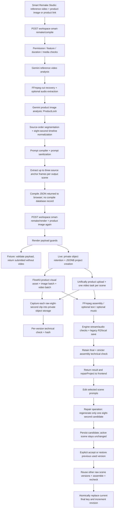

# Smart Remake current pipeline, constraints, verification, and selective repair

Audit date: 24 November 2026 (Asia/Ho_Chi_Minh). This report inspects the actual working tree at base commit `b68d34dc60c076a33ef3f9718b89e60d64047f39`, including existing modified and untracked repair files. No production code was changed, dependencies installed, or paid provider requests made for this report.

Scope update: concurrent unfinished Kie/frontend/config/test changes appeared during final verification. This trace describes the inspected Gemini/Unifically/FlowKit backend paths; it does not certify later provider integration. Line citations may shift after inspection. See [the source-drift boundary](VIRALDY_CURRENT_STATE_AUDIT.md#concurrent-source-changes-during-final-verification).

The executable Smart Remake path is a reference-analysis-to-prompt pipeline followed by fresh product-conditioned video generation. It is not a source-video editing or tracked object-replacement pipeline. Scene retention, candidate regeneration, explicit acceptance, and reconstruction are present in the current working tree; treating all selective repair as a future proposal would miss substantial existing work. Those additions are uncommitted WIP and their presence does not establish deployed, provider-tested behavior.

## Evidence and status conventions

- **Implemented**: an executable path exists in application source. This does not assert production deployment or a successful paid-provider run.
- **WIP implemented**: executable current-tree changes exist but are modified/untracked relative to the audit base; migration application and operational readiness remain unverified.
- **Fixture/test**: deterministic adapters, mocked services, or synthetic media establish software behavior only.
- **Missing in this path**: no implementation was found in the traced Smart Remake path. Other Viraldy modules may expose related capabilities without being integrated here.

GitNexus query/context were used to discover the compile/render flow; the index is ten commits stale and omits recent repair work. Actual source is authoritative. Relevant skills read were `rag-admin-platform` and `.claude/skills/gitnexus/gitnexus-exploring/SKILL.md`. The generic platform skill describes a different repository layout; this audit follows `apps/backend/src/viraldy` and `apps/web/src`, as actually present.

## End-to-end execution flow



API prefix is `/workspaces/{workspace_id}/smart-remake` in [router.py:23](../../apps/backend/src/viraldy/modules/smart_remake/router.py#L23). Both compile and render require `ANALYSIS_RUN`; project read requires `WORKSPACE_READ`; repair/accept/recheck require `ANALYSIS_RUN`. Calls are awaited in the HTTP request. No Smart Remake enqueue step occurs in the traced router/service/orchestrator.

## Stage trace: inputs, outputs, execution, and persistence

| Stage | Input → output; actual algorithm/model | Exact implementation | Errors and persistence | Material limitations |
|---|---|---|---|---|
| Frontend submission | Local video `File`, product `File` or product URL, prompt/description, language, 8/16 seconds → multipart form | `compileSmartRemake`, [smart-remake.ts:105](../../apps/web/src/shared/api/smart-remake.ts#L105); `useRemakeStudio`, [use-remake-studio.ts:306](../../apps/web/src/features/smart-remake/lib/use-remake-studio.ts#L306) | Browser holds compile result and files; HTTP envelope returns data | Public frontend types allow 8/16 only. No character image field. |
| API validation and product-link resolution | Multipart → `CompileSmartRemakeRequest` with byte-bearing `UploadedMedia` | `compile_smart_remake_route`, [router.py:39](../../apps/backend/src/viraldy/modules/smart_remake/router.py#L39); `compile_request`, [service.py:87](../../apps/backend/src/viraldy/modules/smart_remake/service.py#L87) | Rejects feature off, non-9:16, missing video/product; fetches product-link image in a thread pool before compile. No compile DB write. | `_duration` accepts only 8/16 although engine schemas/compiler/render accept 8/16/24/32. Invalid `mode` silently maps to `smart_remake`. `read_media` reads entire upload before downstream size checks. |
| Media checks/normalization | Declared MIME, bytes, metadata → normalized prompt/product context | `assert_reference_video`/`assert_product_image`, [media_validation.py:10](../../apps/backend/src/viraldy/modules/smart_remake/engine/media_validation.py#L10); `compile_smart_remake`, [compile_service.py:72](../../apps/backend/src/viraldy/modules/smart_remake/engine/compile_service.py#L72) | Empty, unsupported MIME, and oversized uploads raise `SmartRemakeValidationError`; stale temporary assets cleaned opportunistically | Default limits are 30 MiB video/10 MiB image, [config.py:4](../../apps/backend/src/viraldy/modules/smart_remake/engine/config.py#L4). MIME checks do not sniff bytes or verify image decoding. No canonical preprocessing/transcoding or durable input facts record. |
| Reference semantic analysis | Full original video bytes plus prompt/description and target duration → normalized `referenceAnalysis` dict | `analyze_reference_video`, [reference_analyzer.py:234](../../apps/backend/src/viraldy/modules/smart_remake/engine/reference_analyzer.py#L234); `HttpGeminiClient._request_text`, [gemini_client.py:168](../../apps/backend/src/viraldy/modules/smart_remake/engine/gemini_client.py#L168) | Default configured model `gemini-2.5-flash`; inline base64 video in Gemini `generateContent`; JSON extraction/comma repair and one additional JSON-repair request. Normalization inserts defaults; forbidden identity-clone phrases raise security error. No raw-response/model-usage DB write in this path. | Model observations are estimates. Text defaults can appear as facts. Runtime normalization returns dictionaries rather than validating the declared `ReferenceAnalysis` model. Fixture client ignores media. |
| Measured cuts and audio | Analysis + original video → optionally enriched source cuts and music asset ID | `enrich_reference_analysis_with_detected_cuts`, [source_shot_detector.py:18](../../apps/backend/src/viraldy/modules/smart_remake/engine/source_shot_detector.py#L18); `_extract_reference_music_if_needed`, [compile_service.py:44](../../apps/backend/src/viraldy/modules/smart_remake/engine/compile_service.py#L44) | FFmpeg scene difference detection and FFprobe duration; detector errors silently preserve original analysis. Audio extraction exceptions become warnings and `referenceMusic.mode=none`. Local temporary files only. | Cut recovery has a dictionary-length comparison defect detailed below. Audio extraction copies the whole audio stream; it does not separate speech/music or verify ownership. |
| Product analysis | Product image bytes + supplied metadata/prompt → normalized `productLock` dict | `generate_product_lock`, [product_lock_generator.py:68](../../apps/backend/src/viraldy/modules/smart_remake/engine/product_lock_generator.py#L68); `normalize_product_lock`, [product_lock_generator.py:14](../../apps/backend/src/viraldy/modules/smart_remake/engine/product_lock_generator.py#L14) | Second sequential Gemini request, image submitted separately from original video. Returns identity, usage guardrails, preserve/change/error lists, symbolic product visual-asset name. No compile persistence. | No embedding, segmentation mask, SKU registry, source-image hash, or calibrated identity confidence. `strict` is a mode label, not stronger visual enforcement. |
| SceneMap/timeline | ReferenceAnalysis + ProductLock + target duration → 1–4 ROOT scenes, each eight seconds, with prompt triplet, `shotPlan`, optional source-segment continuity | `compile_smart_remake_scene_map_with_diagnostics`, [compiler.py:458](../../apps/backend/src/viraldy/modules/smart_remake/engine/compiler.py#L458); `_source_aware_segments`, [compiler.py:192](../../apps/backend/src/viraldy/modules/smart_remake/engine/compiler.py#L192); `normalize_scene_timeline`, [timeline_normalizer.py:221](../../apps/backend/src/viraldy/modules/smart_remake/engine/timeline_normalizer.py#L221) | Deterministic rules; malformed exact timing/zero-duration scaling fails `COMPILER_OUTPUT_INVALID`; normalization warnings returned. No DB record at compile. | A generated scene is an eight-second provider unit containing multiple visual source shots. It is not one source cut. No provider capability or price-based per-scene routing. |
| Prompt construction/guards | Local timeline + source setting/action + target identity → `prompt`, `imagePrompt`, `videoPrompt` | `_compile_scene`, [compiler.py:346](../../apps/backend/src/viraldy/modules/smart_remake/engine/compiler.py#L346); `build_compressed_smart_remake_prompts`, [prompt_compressor.py:229](../../apps/backend/src/viraldy/modules/smart_remake/engine/prompt_compressor.py#L229); `validate_sanitized_compiler_prompts`, [prompt_sanitizer.py:85](../../apps/backend/src/viraldy/modules/smart_remake/engine/prompt_sanitizer.py#L85) | Regex substitutes reference-product descriptors and rejects a small set of contradictory instructions. Prompt text and diagnostics returned to browser. | These are instructions, not independent output checks. Full arbitrary preserve/forbid lists are not compiled into executable rules. See constraint gaps below. |
| Source anchor extraction/compile response | Original video + source timing → local JPEG asset IDs attached to scene; compile JSON returned | `attach_source_frame_assets`, [source_frames.py:17](../../apps/backend/src/viraldy/modules/smart_remake/engine/source_frames.py#L17); `extract_source_frames`, [source_frames.py:50](../../apps/backend/src/viraldy/modules/smart_remake/engine/source_frames.py#L50); return payload, [compile_service.py:190](../../apps/backend/src/viraldy/modules/smart_remake/engine/compile_service.py#L190) | FFmpeg extracts up to three anchors/scene; extraction subprocess failure raises `SMART_REMAKE_SOURCE_FRAME_FAILED`. Returns no video bytes. Build version strings are attached. | Source frames use equal-duration windows, separately from compiler's item-boundary segmentation. They are local temporary assets, not immutable source snapshots, and current live render branches do not submit them. |
| Render intake/retention | Client-supplied compile JSON + product uploaded/fetched again → `RenderSmartRemakeInput`; live path creates repair project | `render_request`, [service.py:162](../../apps/backend/src/viraldy/modules/smart_remake/service.py#L162); `_assert_render_input`, [render_orchestrator.py:43](../../apps/backend/src/viraldy/modules/smart_remake/engine/render_orchestrator.py#L43); `begin_render`, [repair_service.py:268](../../apps/backend/src/viraldy/modules/smart_remake/repair_service.py#L268) | Rejects invalid provider, missing product, ROOT/count/prompt/product-character errors and forbidden reference-video keys. WIP private product upload is preflighted before any video job, then project/context committed. Fixture returns fake IDs/status only. | Server does not load a trusted compile artifact or bind ProductLock to the newly supplied product image. Nested schemas remain loose dicts; prompt sanitizer is rerun only for scenes marked `promptEdited`. |
| Provider execution | Product reference + written scene plan → raw video clip(s) | `render_smart_remake`, [render_orchestrator.py:143](../../apps/backend/src/viraldy/modules/smart_remake/engine/render_orchestrator.py#L143); `_render_with_flowkit`, [render_orchestrator.py:208](../../apps/backend/src/viraldy/modules/smart_remake/engine/render_orchestrator.py#L208); `_render_with_unifically`, [render_orchestrator.py:349](../../apps/backend/src/viraldy/modules/smart_remake/engine/render_orchestrator.py#L349) | FlowKit health/auth → product visual asset → image batch → video batch → polling. Unifically uploads raw product once and sequentially submits/polls each video. WIP per-scene callbacks retain raw bytes and provider IDs. | No original video submission to generation. Unifically makes no initial image-generation request in this route; FlowKit does. Entire operation awaits HTTP completion. Provider completion is not fidelity proof. |
| Assembly/check/save | Clips → concatenated normalized MP4; optional overlays and extracted music → URLs and repair state | `concat_scene_video_records`, [concat.py:94](../../apps/backend/src/viraldy/modules/smart_remake/engine/concat.py#L94); `_finalize_and_save_output`, [render_orchestrator.py:480](../../apps/backend/src/viraldy/modules/smart_remake/engine/render_orchestrator.py#L480); `capture_render_output`, [repair_service.py:338](../../apps/backend/src/viraldy/modules/smart_remake/repair_service.py#L338) | FFmpeg concatenation; FFprobe stream/audio checks; legacy R2/local save; WIP private final retention and technical gate. Router appends `repairProject`, [router.py:125](../../apps/backend/src/viraldy/modules/smart_remake/router.py#L125). | Legacy final can be saved before stricter private-retention gate fails. No semantic inspector or release approval. Output state can remain incomplete with retained scenes after failure. |
| Frontend review/recovery | Render result/repair project → playback, selected scene/version, candidate accept/restore | `useRemakeStudio`, [use-remake-studio.ts:331](../../apps/web/src/features/smart-remake/lib/use-remake-studio.ts#L331); `RemakeVersionReview`, [remake-version-review.tsx:10](../../apps/web/src/features/smart-remake/components/remake-version-review.tsx#L10) | Latest repair project ID stored in workspace-keyed localStorage; project fetched to restore state. API errors can carry recoverable project ID. | UI says technical checks do not assess product or creative quality. No server project-list endpoint in Smart Remake router. Browser convenience state is not an audit log. |

## Contract audit and constraint semantics

### ProductLock

The declared shape is in [schemas.py:86](../../apps/backend/src/viraldy/modules/smart_remake/engine/schemas.py#L86) and [schemas.py:111](../../apps/backend/src/viraldy/modules/smart_remake/engine/schemas.py#L111):

```text
ProductLock
  mode: off | auto | strict
  productName, productType
  visualIdentity: colors[], pattern?, texture?, shape?, material?, visibleBranding?
  productUsage: realisticUseCases[], suitableSurfaces[], contactPoints[],
                handlingInstructions[], usageConstraints[], forbiddenUsageErrors[]
  mustPreserve[], canChange[], forbiddenErrors[]
  productReference: imageUrl?, storageKey?, characterName, entityType=visual_asset
```

`characterName` names the product visual asset, not a person. Normalization title-cases a product subject name and caps it at 80 characters; provider asset IDs are assigned later. The image is the generation identity reference; text identity is descriptive. There is no person identity/consent object, actor reference upload, mask, keypoint graph, feature vector, landmark representation, or independent product-matching result in this contract.

`off` empties `mustPreserve` and `forbiddenErrors`, but shared product-identity text still instructs a single consistent target product. `auto` and `strict` share the same rendering mechanism; no strict-mode-specific measurement or threshold is applied. Normalization prefers model output with selected metadata/list fallbacks. `forbiddenErrors` does not fall back to the caller's previous forbidden list in [product_lock_generator.py:56](../../apps/backend/src/viraldy/modules/smart_remake/engine/product_lock_generator.py#L56).

The compiler emits at most four `mustPreserve` items into the image prompt and five into the video prompt, [prompt_compressor.py:269](../../apps/backend/src/viraldy/modules/smart_remake/engine/prompt_compressor.py#L269), [prompt_compressor.py:297](../../apps/backend/src/viraldy/modules/smart_remake/engine/prompt_compressor.py#L297). It emits product-usage lists and hardcoded consistency negatives, but `canChange` and arbitrary `forbiddenErrors` are not traversed as a general executable constraint set. FlowKit's project description includes the full preserve list, [flowkit_adapter.py:59](../../apps/backend/src/viraldy/modules/smart_remake/engine/flowkit_adapter.py#L59), so transport differs by provider. Neither path verifies the generated product against that list.

### ReferenceAnalysis

The declared schema begins at [schemas.py:290](../../apps/backend/src/viraldy/modules/smart_remake/engine/schemas.py#L290). It includes:

- `analysisOnly=true`; `subjectPresence=none|hands_only|person`.
- Source duration/count, preservation mode, source shots with timing, role/priority, camera/framing, action, product/state/transition descriptions.
- Creative concept/archetype, visual structure, hook type, cardinality, renderability warnings and semantic state transitions.
- Motion beats with optional `PhysicalAction` (`operator`, `targetSurface`, `contactPoint`, `movement`, `visibleEffect`).
- Audio and pacing plans, opening composition and prohibited substitutions, reference identity/branding descriptors to avoid reusing.

The analyzer receives the full original video bytes and is instructed to cover the whole video even for an eight-second target, [prompts.py:42](../../apps/backend/src/viraldy/modules/smart_remake/engine/prompts.py#L42). Normalization defaults missing scenes/camera/actions/opening/audio and infers creative structure. This makes downstream compilation robust but does not distinguish observed, inferred, defaulted, and unknown values consistently. For example the creative router fabricates generic initial/demonstrated state labels when semantic transitions are missing, [creative_router.py:187](../../apps/backend/src/viraldy/modules/smart_remake/engine/creative_router.py#L187).

Human-presence behavior is categorical: product-only forbids people/hands, hands-only forbids faces, and person-present asks for an original generic presenter. `_assert_no_identity_clone_instruction` rejects a phrase list in analysis, [reference_analyzer.py:122](../../apps/backend/src/viraldy/modules/smart_remake/engine/reference_analyzer.py#L122); `_subject_line` writes generic-person instructions, [prompt_compressor.py:102](../../apps/backend/src/viraldy/modules/smart_remake/engine/prompt_compressor.py#L102). This does not establish consistent original character identity across scenes or support replacing one chosen character with another supplied character.

### MediaFacts: no implemented named contract found

Repository search for `MediaFacts`, `mediaFacts`, and `media_facts` found no matching implementation. The actual deterministic media facts are untyped dictionaries returned by `probe_media_file`/`probe_media_bytes`, [media_probe.py:10](../../apps/backend/src/viraldy/modules/smart_remake/engine/media_probe.py#L10). They contain stream flags, duration, audio duration, dimensions/rotation/effective dimensions, codec/container, pixel format, FPS, bitrate, and size. Cut detection separately probes only source duration and attaches a small `sourceCutDetection` summary when enrichment succeeds.

These values are not collected into a shared, versioned MediaFacts record for the reference, product, each scene, and final video. Input image decode/dimensions and source fact provenance are also not recorded. `technicalCheck` persists a hash, checker version, coverage, timestamp, and findings, but not the complete probe payload. A V2 MediaFacts schema should consolidate these existing deterministic primitives instead of claiming a present contract has already been integrated.

### SceneMap and runtime schema enforcement

The declared SceneMap is [schemas.py:348](../../apps/backend/src/viraldy/modules/smart_remake/engine/schemas.py#L348): version/mode, 8/16/24/32-second target, 9:16/VERTICAL, scene count 1–4, and scenes with order, ROOT chain, null parent, prompt triplet, product character name, optional text overlay/source-frame IDs/source segment/shot plan. Its model validator asserts `sceneCount == targetDuration // 8 == len(scenes)`.

However `ProductLock`, `ReferenceAnalysis`, `SceneMap`, and `SmartRemakeCompileResult` are only declarations in the traced runtime. Source search found no instantiation or `validate_model(...)` use outside the declaration helper, [schemas.py:462](../../apps/backend/src/viraldy/modules/smart_remake/engine/schemas.py#L462). Compile normalizers/compiler return raw dicts; `RenderSmartRemakeInput` keeps nested data as `dict[str, Any]`. Only the manual checks in `_assert_render_input` enforce selected nested rules. `SourceShot`'s declared fields also omit `physicalAction` even though reference normalization/timeline compilation carry it as a dictionary field. The intended typed contract and actual pipeline therefore differ.

Public compile input remains 8/16 via [service.py:75](../../apps/backend/src/viraldy/modules/smart_remake/service.py#L75) and web types, while direct engine schema/compiler/render support 24/32. The audit does not count 24/32 as a working public Studio feature.

### Scene boundaries and timeline normalization

1. Gemini proposes real source shots and semantic action beats. FFmpeg may recover additional boundaries using scene-score threshold `0.18`, retrying at `0.10` when analysis suggests missed cuts, minimum shot duration `0.35` seconds, maximum 12 source shots, [source_shot_detector.py:12](../../apps/backend/src/viraldy/modules/smart_remake/engine/source_shot_detector.py#L12).
2. For multiple output scenes, `_source_aware_segments` groups contiguous source shots near equal source time without cutting within a shot. Boundary choice prioritizes time distance, item density, then state evidence. Motion/pacing beats are assigned by midpoint into those source ranges, [compiler.py:88](../../apps/backend/src/viraldy/modules/smart_remake/engine/compiler.py#L88).
3. If insufficient source-shot boundaries exist, action intervals drive segmentation; empty local source-shot lists prevent copying a full one-take into both clips. Broad single actions can be reused with explicit local source intervals, [compiler.py:212](../../apps/backend/src/viraldy/modules/smart_remake/engine/compiler.py#L212).
4. Each scene receives local opening/state metadata, source time range, source-cut or continuous-handoff marker, and previous/opening state continuity, [compiler.py:165](../../apps/backend/src/viraldy/modules/smart_remake/engine/compiler.py#L165).
5. When source shots exist, `normalize_scene_timeline` forces exact shot preservation regardless of an incoming adaptive label. It proportionally rescales each shot into eight seconds, rounding to 0.1 seconds, and assigns the final shot the remaining time. It retains source indices/times. More than six cuts yields a density warning rather than model rerouting, [timeline_normalizer.py:179](../../apps/backend/src/viraldy/modules/smart_remake/engine/timeline_normalizer.py#L179).
6. Without source shots, role/priority/state heuristics choose a 1–4-shot budget, remove optional beats and merge compatible supporting beats, preserving state-changing mandatory beats. Mandatory overload raises only for a single output scene at `_compile_scene`; multiscene overload is returned as warning, [compiler.py:348](../../apps/backend/src/viraldy/modules/smart_remake/engine/compiler.py#L348).

This is useful source-aware deterministic compilation, but exact source-cut execution is requested in prose from a generative model. No generated cut detection or alignment compares actual output against the planned cut times.

**Confirmed software defect:** after expansion, `enrich_reference_analysis_with_detected_cuts` compares `len(expanded)` with the count of existing source shots, [source_shot_detector.py:55](../../apps/backend/src/viraldy/modules/smart_remake/engine/source_shot_detector.py#L55). `expanded` is a four-key dictionary returned by `expand_source_shots_to_cut_boundaries`, [source_shot_detector.py:163](../../apps/backend/src/viraldy/modules/smart_remake/engine/source_shot_detector.py#L163). Therefore references already described as four or more shots return the original analysis even when additional cuts were detected. An offline reproduction patched cut detection to return an eight-second source with cuts at seconds 1–7 and supplied four analyzed shots: direct expansion returned eight shots, while enrichment returned the original four. No provider was called. The defect is left unchanged under this audit's documentation-only scope; this is not a measured generation-quality result.

Other planning limitations:

- `route_creative_structure` chooses descriptive strategies and warns on split screen, mixed media, screen recording, text/voice hooks, comparisons, and multiple products, [creative_router.py:229](../../apps/backend/src/viraldy/modules/smart_remake/engine/creative_router.py#L229). It does not choose a different generation model, editing algorithm, scene duration, or fallback path. `renderability.supported=false` is not a hard render gate in this flow.
- The normalizer can preserve a slow cinematic profile while `_timeline_lines` and the video prompt always demand fast purposeful product-demo motion, [prompt_compressor.py:152](../../apps/backend/src/viraldy/modules/smart_remake/engine/prompt_compressor.py#L152), [prompt_compressor.py:281](../../apps/backend/src/viraldy/modules/smart_remake/engine/prompt_compressor.py#L281). This is a prompt contradiction to resolve before expanding adaptive routing.
- Source-frame anchors are chosen from equal-length source windows, [source_frames.py:122](../../apps/backend/src/viraldy/modules/smart_remake/engine/source_frames.py#L122), while the compiler segments at source item boundaries. The two assignments can differ.

### Preservation, replacement, prohibition, and independent verification

| Requirement | Existing enforcement | Independently verifiable today? | Reusable V2 component |
|---|---|---|---|
| Product color, silhouette, material/components | Gemini description, uploaded product image, preserve lists, repeated prompt negatives | No generated-product crop, identity match, logo OCR, or attribute comparison | ProductLock fields + image storage + per-scene media hash |
| Keep source scene/action/cut order and result | Source shots, physicalAction, sourceSegment, normalized shotPlan, causality prose | No output temporal alignment or state-transition verification | Source segmentation, exact timeline, cut detector, shotPlan |
| Replace source product | Descriptor sanitization + raw target product provider reference | No object tracking, replacement mask, or source-product absence check | Sanitizer and source/target identity separation |
| Preserve human-presence category without copying identity | Analysis phrase blocklist, subject prompt rules, limited regex validation | No person/face detector or cross-scene character comparison | `subjectPresence` and original generic presenter policy |
| Forbid original logos/captions/wording | Literal-term sanitizer, generic negatives, no-reference-video keys | No generated OCR/ASR/brand check | Existing literal constraints as input checks only |
| Physically correct contact/movement/effect | PhysicalAction, productUsage, causal state descriptions | No geometry/contact/optical-flow/plausibility inspector | Structured mechanics fields and time anchors |
| Technical 9:16/eight-second output | WIP technical check and private activation gate | Yes, limited to FFprobe-visible metadata and hash | `technical_check` and `_compose` |

No constraint IDs, provenance/confidence per rule, severity, allowed tolerance, checker mapping, override reason, or evidence-linked pass/fail results are implemented in these contracts. A schema version string is not evidence that a condition held.

## Provider boundary, errors, and storage behavior

Reference-video bytes go to Gemini analysis. They are intentionally absent from live generation input. `assert_no_reference_video_in_render_payload` recursively rejects a named set of reference-video keys, [guards.py:14](../../apps/backend/src/viraldy/modules/smart_remake/engine/guards.py#L14), and blocks `GENERATE_VIDEO_REFS`. This protects the supported payload shape; it is not a general semantic detector for every possible encoded video reference in arbitrary strings.

Current FlowKit preparation uploads only the product image, associates it with a product `visual_asset`, and creates scenes from prompt fields, [flowkit_adapter.py:118](../../apps/backend/src/viraldy/modules/smart_remake/engine/flowkit_adapter.py#L118). It does not read attached source-frame assets. Current Unifically orchestration explicitly uses only the raw product upload as visual ingredient, with source information in written shot plans, [render_orchestrator.py:373](../../apps/backend/src/viraldy/modules/smart_remake/engine/render_orchestrator.py#L373). Source-frame helper functions/flags elsewhere in adapters do not establish that this live call path submits them. Full provider payloads and capability distinctions are in [MODEL_PROVIDER_CAPABILITY_AUDIT.md](MODEL_PROVIDER_CAPABILITY_AUDIT.md).

Gemini uses a 120-second default per HTTP request (environment-configurable and clamped 5–300 seconds), four attempts for selected 429/5xx responses with backoff/Retry-After, and early stop on billing markers. Network/timeout exceptions fail immediately; invalid JSON can cause one more full request, [gemini_client.py:130](../../apps/backend/src/viraldy/modules/smart_remake/engine/gemini_client.py#L130). Normalized stage errors are converted by `_error` to HTTP 400, [service.py:64](../../apps/backend/src/viraldy/modules/smart_remake/service.py#L64), even when the underlying issue is provider availability. Unexpected render exceptions become `SMART_REMAKE_RENDER_INTERRUPTED`/503 and may expose a repair project ID if at least one scene was retained, [router.py:111](../../apps/backend/src/viraldy/modules/smart_remake/router.py#L111).

FlowKit polls image and video batches, with failure capture of any available scene clips. A completed batch without all `output_url` values can return `status=submitted`, blank final URL, and provider IDs, [render_orchestrator.py:288](../../apps/backend/src/viraldy/modules/smart_remake/engine/render_orchestrator.py#L288). Unifically polls each scene sequentially and optionally retries one rejected payload without a seed; a submission HTTP 5xx is not automatically retried because it may already have started a paid job, [render_orchestrator.py:121](../../apps/backend/src/viraldy/modules/smart_remake/engine/render_orchestrator.py#L121).

Assembly normalizes clips to 720×1280 vertical H.264, 24 FPS, yuv420p, AAC, then concatenates, [concat.py:94](../../apps/backend/src/viraldy/modules/smart_remake/engine/concat.py#L94). A single Unifically clip bypasses concatenation. Overlays require `SMART_REMAKE_RENDER_TEXT_OVERLAYS`; missing drawtext/font support can make overlays a no-op. Engine finalization requires a video stream and optionally usable native audio duration over 0.1 seconds; reference-music mux is warning-only unless required. It does not enforce target duration or aspect ratio at this stage.

There are two storage paths, with different semantics:

1. **Legacy engine final output:** `save_smart_remake_output` writes a public R2 object when configured or atomically saves a local `/outputs/renders/...` file; R2 failure falls back to local and prints a warning, [storage.py:25](../../apps/backend/src/viraldy/modules/smart_remake/engine/storage.py#L25). No immutable revision manifest is written here.
2. **WIP repair retention:** `RepairMediaStore` stores random object keys under a workspace/project prefix using the platform `StoragePort`; all later reads use server-owned keys and generated presigned URLs, [repair_media.py:93](../../apps/backend/src/viraldy/modules/smart_remake/repair_media.py#L93). Product, optional reference music, each raw scene version, and final assembly are retained. Current API creates this store for every non-fixture render, so private storage and repair migration availability are now prerequisites for live rendering.

The render `finally` block deletes referenced local source-frame/music assets, [render_orchestrator.py:179](../../apps/backend/src/viraldy/modules/smart_remake/engine/render_orchestrator.py#L179). Opportunistic cleanup removes local temp assets after 24 hours by default and local final outputs after seven days; R2 finals are untouched, [asset_cleanup.py:14](../../apps/backend/src/viraldy/modules/smart_remake/engine/asset_cleanup.py#L14), [config.py:14](../../apps/backend/src/viraldy/modules/smart_remake/engine/config.py#L14). Repair context retains source-frame IDs inside SceneMap but does not copy the JPEGs or original reference video to private storage. These IDs can therefore become dangling analysis artifacts after render. Repair explicitly strips source-frame fields and temporary music ID before regeneration.

## Output verification taxonomy

| Category | Status in Smart Remake | Exact checks/evidence | Limits |
|---|---|---|---|
| Input media sanity | Implemented | Declared MIME allowlist, nonempty bytes, byte limits in `media_validation.py`; FFmpeg operations incidentally validate some video usability | Not output quality; no image magic-byte sniff/decoder check before provider |
| Provider task completion | Implemented | Batch/task polling and output URL presence in render orchestrator | A completed task can produce a semantically wrong video |
| Final engine technical validation | Implemented | `probe_media_bytes` + video presence + audio duration >0.1 seconds when required, `_finalize_and_save_output` | No aspect/duration/FPS/bitrate threshold; FFprobe metadata is not full-frame decoding |
| Scene/final technical validation | WIP implemented | `technical_check`: video stream; effective 9:16 ratio within 0.02; duration within 0.5 seconds of expected 8 or project target; audio stream if required; SHA-256; timestamp/checkerVersion/coverage, [repair_media.py:24](../../apps/backend/src/viraldy/modules/smart_remake/repair_media.py#L24) | No minimum resolution, actual frame decode, black/frozen frames, audio loudness/clipping/continuity, synchronization, codec profile or valid advertising text checks. Required audio tests stream presence, not audibility/duration. |
| Stored-media integrity | WIP implemented | `_compose` compares stored bytes with version hash; `check` reruns technical check and fails if hash changed, [repair_service.py:603](../../apps/backend/src/viraldy/modules/smart_remake/repair_service.py#L603), [repair_service.py:711](../../apps/backend/src/viraldy/modules/smart_remake/repair_service.py#L711) | Hash says bytes unchanged, not correct |
| Product fidelity | Missing output measurement | Input ProductLock/product image and prompt instructions only | No generated crop/embedding/attribute/logo comparison or scored findings |
| Structural fidelity | Missing output measurement | Input cut detector + normalized shotPlan only | No generated cut alignment, action order/coverage/result consistency check |
| Character consistency | Missing output measurement | Generic presence-category constraints only | No character registry, character reference conditioning, face/body consistency assessment |
| Motion consistency | Missing output measurement | MotionBeat/physicalAction/camera language only | No optical flow, trajectory/keypoint comparison, temporal image embedding or contact assessment |
| Physical plausibility | Missing output measurement | ProductUsage and demo causality instructions | No detector/model-based plausibility findings |
| Advertising claim accuracy | Missing output verification in this path | Product prompt says not to invent claims, [prompts.py:144](../../apps/backend/src/viraldy/modules/smart_remake/engine/prompts.py#L144) | No generated OCR/ASR tied to allowed/prohibited claims or seller evidence |
| Human review | Partial, WIP candidate acceptance | UI compare/review language and backend explicit accept/restore endpoint; accept blocks failing technical check | Initial valid clips autoactivate; initial final becomes ready automatically. No independent reviewer identity, required review rubric, rights attestation, release artifact approval or export gate. |

Technical checks are real executable checks, not semantic mocks. Their inputs in most unit tests are mocked probes/bytes. Tests explicitly avoid claiming semantic quality, [test_smart_remake_repair.py:60](../../apps/backend/tests/unit/test_smart_remake_repair.py#L60). UI labels likewise say a technical pass does not assess product correctness or creative quality, [remake-version-review.tsx:32](../../apps/web/src/features/smart-remake/components/remake-version-review.tsx#L32).

### Hybrid Inspector integration seams (recommendation only)

1. **Source facts and constraint snapshot:** before compile, persist the original reference/product assets and hashes, deterministic MediaFacts, cut list, and observation provenance. This avoids depending on temporary frames that disappear after render. Bind the exact compile version to those assets.
2. **Scene candidate inspection:** extend the existing `on_scene_output`/`_new_version` boundary, [render_orchestrator.py:153](../../apps/backend/src/viraldy/modules/smart_remake/engine/render_orchestrator.py#L153), [repair_service.py:60](../../apps/backend/src/viraldy/modules/smart_remake/repair_service.py#L60). Run technical rules first, then sampled-frame/object/OCR checks, crop embeddings for target-product similarity, and multimodal time-local judgments for action/contact/state constraints. All of these semantic methods are proposed, not present.
3. **Evidence contract:** store findings keyed by media hash, scene/version, source/constraint snapshot, checker/model/config version, covered time interval, evidence frames/segments, confidence, severity, and `passed|failed|needs_review|not_checked`. Technical pass and semantic confidence must remain separately visible. An unobserved event must not automatically become a failed or absent event.
4. **Assembly verification:** invoke after `_compose` and before accept commits, [repair_service.py:633](../../apps/backend/src/viraldy/modules/smart_remake/repair_service.py#L633). Recheck cross-scene continuity, audio/text/claim integrity, and dependency-linked findings affected by the replacement; unchanged scene media can reuse valid checks keyed to its hash.
5. **Human decision and release:** extend explicit accept with review records and a distinct release decision against an immutable assembly revision. Current `activeVersionId` is a useful selection mechanism, but is not evidence of a complete release review.

Use deterministic rules for things that can be measured (duration/dimensions/cut timing/hash), visual methods for product localization/similarity/text, and multimodal models for uncertain action/state/physical interpretation. Calibrate thresholds and disagreement behavior on labeled generated clips before enabling blocking gates. Do not label an embedding similarity value as verified identity without evaluation.

## Selective scene repair: actual capability and limits

### Data model and operation state

The WIP migration [0023_smart_remake_scene_repair.py](../../apps/backend/alembic/versions/0023_smart_remake_scene_repair.py) and models [models.py:15](../../apps/backend/src/viraldy/modules/smart_remake/models.py#L15) add:

- `smart_remake_projects`: UUID, workspace foreign key, revision, JSONB current state/context, creation timestamp.
- `smart_remake_operations`: project foreign key, idempotency key/request hash, running/completed/failed status, JSONB result and creation timestamp; unique `(project_id, idempotency_key)`.

State contains fixed eight-second scene slots, per-scene version arrays and active version ID, current final object key, and assembly check. Version records hold UUID/parent, prompt triplet, source generated/regenerated, private storage key, media hash, technical check, provider metadata, createdAt, and `usedByRevision`. Context contains initial SceneMap, ProductLock, ReferenceAnalysis, product key/MIME, audio requirement/name/overlays and optional retained music key, [repair_service.py:284](../../apps/backend/src/viraldy/modules/smart_remake/repair_service.py#L284).

Compile build strings (`reference-analyzer-v1`, `product-lock-v1`, `compiler-v2`, `scene-map-v1`) at [compile_service.py:217](../../apps/backend/src/viraldy/modules/smart_remake/engine/compile_service.py#L217) are schema/build labels, not immutable artifact revisions. Repair does not retain the full compile response, compiler diagnostics, inputSummary, prompt template hash, requested/effective model config, source asset hash, cost or usage in context.

### Regenerate, reconcile, accept, and restore

- `POST /projects/{project_id}/scenes/{scene_id}/repairs` accepts strict Pydantic JSON with internal `baseVersionId`, expected revision, three nonblank prompts (maximum 12,000 characters each) and idempotency key; extra fields, including arbitrary media URLs, are forbidden, [repair_schemas.py:8](../../apps/backend/src/viraldy/modules/smart_remake/repair_schemas.py#L8).
- `RepairRepository.start` row-locks the workspace-owned project, replays the same key/hash, conflicts on changed request/key reuse, blocks concurrent project operations, and caps all operation records at 100/project, [repair_repository.py:47](../../apps/backend/src/viraldy/modules/smart_remake/repair_repository.py#L47).
- `repair` checks project revision and active base, copies the server-owned initial scene, applies edited prompts, validates sanitizer/Unifically edit-direction budget, removes source-frame references, loads retained product, and constructs a one-scene/eight-second render. Its original `sourceSegment`/shotPlan stay attached, so repairing segment two keeps its assigned source interval, [repair_service.py:403](../../apps/backend/src/viraldy/modules/smart_remake/repair_service.py#L403).
- The Unifically edited direction uses a `SequenceMatcher` diff against the initial owned prompt, with a total 2,200-character direction budget and focused context; exceeding it raises instead of silently truncating user edits, [prompt_edits.py:61](../../apps/backend/src/viraldy/modules/smart_remake/engine/prompt_edits.py#L61). This is prompt control, not motion/object editing of the prior video.
- Provider task metadata is committed during repair submission. A candidate is appended after successful clip retention/technical checking; it is not automatically activated. Ambiguous timeout/status/download/storage failures leave the operation running with `needsReconciliation=true`, [repair_service.py:537](../../apps/backend/src/viraldy/modules/smart_remake/repair_service.py#L537).
- `GET /projects/{id}` can reconcile the last persisted task and download its existing output without creating another task, [repair_service.py:183](../../apps/backend/src/viraldy/modules/smart_remake/repair_service.py#L183). Definitive task failure ends the operation; otherwise refresh can leave it unresolved. This is demand-driven HTTP reconciliation, not a durable background worker.
- `POST /projects/{id}/accept` rejects stale never-used candidates and technical failures; a previously used version can be restored. It reads/re-hashes all active raw scene clips, adds silent audio tracks where necessary, reassembles, optionally remuxes retained music, technical-checks final output, uploads it, rechecks revision under a lock, and commits state/operation together, [repair_service.py:641](../../apps/backend/src/viraldy/modules/smart_remake/repair_service.py#L641). Other scene media is reused without generation, but the entire final video is reconstructed.
- `POST .../versions/{version_id}/checks` reruns technical inspection and verifies media hash, [router.py:187](../../apps/backend/src/viraldy/modules/smart_remake/router.py#L187). No frontend client method or review button invokes this endpoint in [smart-remake.ts:160](../../apps/web/src/shared/api/smart-remake.ts#L160); the server capability currently exceeds the connected UI surface.

### Editing support matrix

| Capability | Current support | Evidence / boundary |
|---|---|---|
| Scene-level private storage | WIP implemented for new live renders | `begin_render` + per-scene capture. Old legacy finals have no backfill/import endpoint. |
| Individual scene replacement | WIP implemented by selecting retained version and rebuilding final | `accept`; no binary patch/edit of existing clip. |
| Selective regeneration | WIP implemented for one eight-second slot | `repair` creates one-scene render and retains candidate. Both providers use existing generation paths. |
| Sub-shot repair or variable-length timeline editing | Missing | Slot duration is fixed at eight seconds; source cuts inside a slot cannot be independently replaced. |
| Prompt editing | WIP implemented | Three prompt fields, sanitizer and provider direction budget; source-shot/state contract is inherited. |
| Version history | Partial WIP | Scene candidates/parents/hashes retained in JSONB. No immutable full project/assembly revision graph. |
| Before/after comparison | WIP frontend support | Review/player plus active/candidate version selection; backend provides URLs. No semantic diff or synchronized fact comparison. |
| Undo/rollback | Partial WIP | Accept previously used version, reconstruct, increment revision. No complete undo stack or restore entire assembly manifest. |
| Reuse approved scenes | WIP within one project | Reuses active clips with passed technical checks. “Approved” means selected/used; no semantic/rights approval state or cross-project scene library. |
| Final assembly | Implemented engine + WIP repair composition | FFmpeg normalization/concat/music; technical gate and hash reads on accept. |
| Re-verification after editing | WIP technical only | Scene check + final assembly check. No product/structural/character/motion/claims review. |
| Operation idempotency/concurrency | WIP implemented | Row lock, request hash, replay, revision/base conflict, busy guard. No initial-render reservation. |
| Crash recovery | Partial WIP for repairs | Persisted repair task reconciliation. Initial render lacks persisted task submission callbacks/reservation. |
| Durable project discovery | Partial | GET by ID; browser caches latest ID. No list/search endpoint or worker-driven recovery index. |
| Final export/release gate | Missing in this path | Presigned download exists, but no review/rights requirement before download or initial “ready” state. |

### Operational gaps to preserve in V2 planning

1. **Initial render recovery gap:** router passes `begin_render` into service, but service passes only `on_scene_output` to `render_smart_remake`, [service.py:231](../../apps/backend/src/viraldy/modules/smart_remake/service.py#L231). Initial provider task IDs are not persisted via `on_task_submitted`. A process failure after paid task creation but before clip capture leaves an incomplete project without the reconciliation metadata used by repair operations. A project with zero retained versions is not returned as recoverable by `recoverable_project_id`, [repair_service.py:262](../../apps/backend/src/viraldy/modules/smart_remake/repair_service.py#L262).
2. **Awaited operations:** request timeouts or browser disconnects do not provide a durable scheduler. There is no operator cancellation/lease-expiry route; an unresolved running operation blocks all new operations on the project. Reconciliation handles recorded task retrieval but cannot know every task that was created if the process failed before its ID commit.
3. **Mutable histories:** scene media blobs are content-hashed, but project state is overwritten JSONB. `usedByRevision` records a single latest use, not every usage. Acceptance overwrites current final key without storing an assembly manifest/history of all selected version IDs. Old objects may remain in storage without a discoverable revision record.
4. **Confirmed partial-project completion defect:** accept cannot assemble until every scene has an active version. A project with several missing/technically invalid slots can generate candidates for them, but the API accepts one version at a time and each accept immediately requires all other slots active. An offline call to the actual `RepairService.accept` with existing in-memory repository/media test doubles, two inactive slots, and a passing second-slot candidate returned `SMART_REMAKE_SCENE_MISSING`, left revision at 1 and both slots inactive, and performed zero object writes. No batch selection/accept endpoint finishes several missing slots atomically; recovery is blocked when more than one slot lacks an active version.
5. **No semantic approval:** initially generated technically valid versions autoactivate. Candidates require explicit acceptance but no rights/product/claim review record. Recheck can mark an active version failed without invalidating current `ready` status/final storage key or gating download, [repair_service.py:730](../../apps/backend/src/viraldy/modules/smart_remake/repair_service.py#L730). This leaves the active-scene/approval dependency state stale; it does not prove previously assembled final bytes are damaged, because the final is stored separately.
6. **Retention/lifecycle gaps:** private uploads precede some DB/state changes; failed probes, races, or acceptance failures can leave orphan objects. No repair-specific deletion, retention expiry, project list/archive, or object GC endpoint exists in this router.

## Minimum V2 work built on this implementation

The smallest useful Editing Room is completion/hardening of the existing candidate-review-reassemble path, not a parallel editor implementation.

| Priority | Minimal change | Dependencies | Acceptance criterion |
|---|---|---|---|
| P0 | Establish trusted compile artifact and input binding | Durable reference/product asset keys + hashes; enforced nested schemas; compiler/prompt/config revision | Render uses server-owned compile ID; substituting product bytes or mutable client constraints is rejected or explicitly recompiled. Every generated version points to exact input/constraint snapshot. |
| P0 | Finish retained-scene repair recovery | Apply migration; initial task reservations/IDs; durable job state; existing idempotency/revision logic | Initial and repair requests survive disconnect/restart; refresh retrieves an existing paid job; no duplicate create for an ambiguous submission; multiple missing scene slots can be activated atomically. |
| P0 | Unify technical facts and activation gates | Existing probe/technical_check, immutable assembly manifest, object ownership/lifecycle | Same checks govern initial/repaired/exported video; failed recheck invalidates affected release state; every final revision records all selected scene-version hashes. |
| P0 | Verify one scene repair vertical slice | Controlled generated clips with rights and retained task logs; candidate accept/rollback and actual reconstruction | Repair one faulty scene; unchanged scene hashes preserved; failed candidate cannot replace current final; user can compare and restore; measured cost/latency attached to provider tasks. |
| P1 | Add evidence-linked product/structure Inspector | Retained original/reference facts and ProductLock/shotPlan constraints; labeled evaluation set | Inspector returns time-local findings and explicit uncovered/needs-review states; cached checks are bound to media+constraint hash; known product/cut-order errors detected at calibrated rates. |
| P0 | Enforce minimal human approval, rights attestation, and private release | Immutable assembly manifest; scoped approval/rights record; protected download endpoint | A reviewer approves a specific final revision and required source/music/product/character permissions; release/download rejects missing decisions and stale approval dependencies. Richer Inspector-assisted review can follow at P1. |
| P1 | Route scenes by measured constraint difficulty | Correct cut recovery, consistent pacing prompts, provider capability matrix, inspector outcomes/cost logs | Multi-shot/continuous/text/character cases choose explicit supported execution plans with recorded fallback reason; same input plan is reproducible. |
| P2 | Add variable-duration cuts, cross-project approved scene reuse, multiplier/export variants | Stable revision graph, source rights lineage, assembly/check invalidation | New variants share immutable approved clips and recheck changed dependencies; provenance and costs remain attributable per final variant. |

The reuse candidates for a Remake Constraint Engine are ProductLock's identity/usage vocabulary, ReferenceAnalysis physical actions and state transitions, deterministic source segmentation/timeline, sanitizer's pre-generation guards, SceneMap/shotPlan, version media hashes, idempotent operations, and technical check coverage. They need a typed provenance-aware constraint snapshot and checker results; they currently do not form a verifiable constraint engine by themselves.

## Test and runtime evidence boundary

Relevant existing tests include:

- [test_smart_remake_integration.py](../../apps/backend/tests/unit/test_smart_remake_integration.py): compiler/reference/product/provider-adapter contracts and fixture/mocked execution. Its filename does not mean a paid provider was exercised.
- [test_smart_remake_repair.py](../../apps/backend/tests/unit/test_smart_remake_repair.py): strict request shape, technical-check behavior, prompt/provider edit propagation, and no semantic-quality claims.
- [test_smart_remake_repair_service.py:152](../../apps/backend/tests/unit/test_smart_remake_repair_service.py#L152): mocked one-scene regeneration, accept/restore, assembly failure preservation, workspace scope, stale candidates, invalid initial media, and recorded-task reconciliation.
- [test_smart_remake_scene_outputs.py:33](../../apps/backend/tests/unit/test_smart_remake_scene_outputs.py#L33): fake provider output retention, FlowKit partial failure and ambiguous submission behavior.
- [test_smart_remake_repair_media.py:16](../../apps/backend/tests/unit/test_smart_remake_repair_media.py#L16): actual FFmpeg-generated synthetic clips and real assembly/audio preservation. This is real local media processing, not real product fidelity or provider generation evidence.
- [test_smart_remake_repair_persistence.py:21](../../apps/backend/tests/integration/test_smart_remake_repair_persistence.py#L21): Testcontainers PostgreSQL migration/ownership/concurrent reservation test definition. Requires Docker/PostgreSQL; its presence does not prove the deployment migration is applied.
- [fixture.py:6](../../apps/backend/src/viraldy/modules/smart_remake/fixture.py#L6): deterministic Gemini substitute discards media. Fixture render reports submitted with empty URL and explicitly no video-provider call, [service.py:209](../../apps/backend/src/viraldy/modules/smart_remake/service.py#L209).

This report's conclusions are source-trace findings. No paid generation or deployment check was run for it; test execution/results and experiment provenance are separately reported in [EXPERIMENT_EVIDENCE_AUDIT.md](EXPERIMENT_EVIDENCE_AUDIT.md). Missing semantic measurements must remain missing/unknown rather than being inferred from passing fixture tests, successful media assembly, schema names, or prompt wording.
