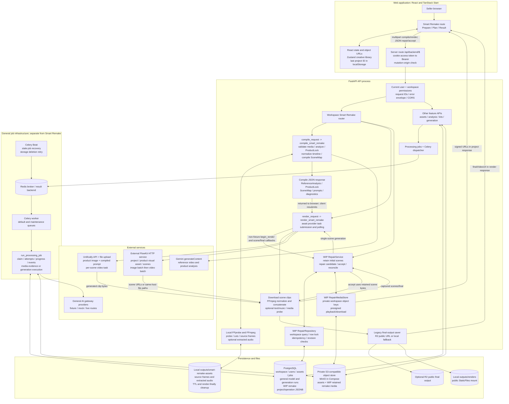

# Viraldy: current architecture and product surface

Audit date: 2026-11-24 (Asia/Ho_Chi_Minh). Baseline HEAD: `b68d34dc60c076a33ef3f9718b89e60d64047f39`. This report describes the inspected **working tree**, including pre-existing, uncommitted Smart Remake repair and studio changes. Source implementation is evidence of an executable code path, not evidence that a deployment has enabled it, applied its migrations, or completed a real provider run. No production code was changed for this audit.

**Late concurrent-change boundary — 2026-11-24 23:32:52 +07:00:** source files changed outside this audit while inspection was in progress. A late read found frontend `kieConfigured` preference, `provider="kie"` types, render `idempotencyKey` plumbing, backend `get_kie_api_key`, and a new Kie test module importing adapters not present at that cutoff. These additions are **concurrent WIP, not a verified backend Kie route or durable render implementation**. The architecture diagram and backend execution trace below reflect the inspected Gemini/Unifically/FlowKit paths. Source links identify the inspected locations; line numbers may shift as that separate work continues. See [late frontend selection](../../apps/web/src/features/smart-remake/lib/smart-remake-render.ts#L47), [late API form](../../apps/web/src/shared/api/smart-remake.ts#L138), [configuration addition](../../apps/backend/src/viraldy/modules/smart_remake/engine/config.py#L91), and [new test imports](../../apps/backend/tests/unit/test_smart_remake_kie.py#L10).

## 1. Architectural conclusion

Viraldy is a Python FastAPI modular monolith with a separate Celery worker and a React/TanStack Start web application. Smart Remake is a feature module inside that backend. Its compile, render, repair, and composition calls currently **await work within HTTP requests**; they do not dispatch Smart Remake jobs to Celery. The general asset analysis and concept generation infrastructure has a different, durable job path. Treating those two paths as already unified would conceal the largest orchestration gap.

The frontend is React 19, TanStack Router/Start, Vite, Tailwind, Radix, TanStack Query and Zustand, with Nitro configured for Vercel builds. It is not the Next.js application described by the generic RAG platform skill. Evidence: [web dependencies](../../apps/web/package.json#L1), [Vite plugins and server entry](../../apps/web/vite.config.ts#L20), [QueryClient/router construction](../../apps/web/src/app/router.tsx#L5).

Status vocabulary used here: **implemented** means present and wired in source; **WIP implemented** additionally identifies pre-existing uncommitted code; **fixture/mock** means simulated inputs, outputs, or provider behavior; **planned/missing** means no corresponding Smart Remake execution path was found. None implies independently verified creative fidelity.

## 2. Actual implementation diagram

Diagram boundaries are intentional: there is no Smart Remake → Celery edge, no Smart Remake → general `ai_model_runs` edge, and no generation-provider input edge carrying the source video. The source video is used during analysis; compiled descriptions carry its structure into generation. The Unifically active render path sends the product upload as its visual ingredient ([render provider branch](../../apps/backend/src/viraldy/modules/smart_remake/engine/render_orchestrator.py#L349)); FlowKit receives project/product/scene metadata and batch requests ([adapter](../../apps/backend/src/viraldy/modules/smart_remake/engine/flowkit_adapter.py#L118)). Model payload details and dormant helper paths are audited separately in [provider capabilities](MODEL_PROVIDER_CAPABILITY_AUDIT.md).

The renderer saves a legacy public/local final output and then supplies the same final bytes to the private repair callback. The private retention path therefore does not replace the legacy public-output path. See [FlowKit finalization/callback](../../apps/backend/src/viraldy/modules/smart_remake/engine/render_orchestrator.py#L311), [output saver](../../apps/backend/src/viraldy/modules/smart_remake/engine/storage.py#L25), and [private final capture](../../apps/backend/src/viraldy/modules/smart_remake/repair_service.py#L338).

## 3. Frontend and request boundary

| Surface | Actual implementation and status | Important limit |
| --- | --- | --- |
| `/smart-remake` | Route export [entry](../../apps/web/src/routes/smart-remake.tsx#L1); WIP `SmartRemakePage` resolves workspace, then `SmartRemakeStudio` composes the flow [route](../../apps/web/src/features/smart-remake/routes/smart-remake-route.tsx#L24). | Workspace changes remount the studio. No project-ID permalink or project index route is present in this route. |
| Prepare → Plan → Result | WIP `useRemakeStudio` owns files, selected product image, brief, compile result, prompt drafts, result, project and busy/error state [hook](../../apps/web/src/features/smart-remake/lib/use-remake-studio.ts#L30). | File inputs and compile drafts are session state. A browser-local last-project ID restores retained projects; it is not a server project catalog. |
| Smart Remake API client | Multipart `compileSmartRemake` and `renderSmartRemake`; JSON project/repair/accept calls [client](../../apps/web/src/shared/api/smart-remake.ts#L102). | Frontend contract is 8/16 seconds, 9:16, 1/2 generated scenes. It always sets `audioRequired=false` [render form](../../apps/web/src/shared/api/smart-remake.ts#L149). Late concurrent edits add optional render idempotency and Kie types; backend enforcement was not established. |
| Browser API transport | Shared client calls same-origin `/api/backend`, unwraps envelopes, and refreshes on 401 [transport](../../apps/web/src/shared/api/client.ts#L7). | `VITE_API_BASE_URL` is not directly fetched from browser; the server proxy uses it. |
| Server BFF | `proxyBackend` validates mutation origin, takes token from cookie, adds Bearer auth, forwards selected headers, streams upstream response, and returns `Cache-Control: no-store` [proxy](../../apps/web/src/routes/api.backend.$.ts#L17). | Long render calls keep this upstream request open too. Proxy failure is a 502; it is not a durable render status. |
| Creative Library | Existing `/creative-library` routes and browser-local creatives can hand files into Smart Remake; `RemakeVideoLibrary` reads `useAppStore` [library](../../apps/web/src/features/smart-remake/components/remake-video-library.tsx#L28). | The library explicitly labels itself browser-local [label](../../apps/web/src/features/smart-remake/components/remake-video-library.tsx#L121); it does not establish backend ownership or rights. |
| Adjacent reusable features | `/ugc-review/$assetId`, `/tiktok-scorer/$scoreId`, score comparison, `/campaigns/$campaignId`, `/products` exist. [UGC evidence player](../../apps/web/src/features/ugc-review/components/review-video-panel.tsx#L20), [score comparison route](../../apps/web/src/features/tiktok-scorer/routes/tiktok-scorer-compare-route.tsx#L33). | These are separate domains. Existing review/scoring UI and backend evidence do not automatically inspect generated Smart Remake output. |

Provider selection is automatic in `renderSmartRemakeVideo`. At primary inspection it selected fixture in fixture health mode; otherwise Unifically when configured, otherwise FlowKit. The late concurrent edit inserts `health.kieConfigured → "kie"` ahead of Unifically [selection](../../apps/web/src/features/smart-remake/lib/smart-remake-render.ts#L47); that client branch alone does not prove an executable Kie backend. Demo playback requires explicit `demo=true` and uses an optional static example [demo branch](../../apps/web/src/features/smart-remake/lib/smart-remake-render.ts#L38). The inspected route visibly labels fixture mode [banner](../../apps/web/src/features/smart-remake/routes/smart-remake-route.tsx#L195). Neither fixture validation nor example playback is a completed provider render.

## 4. Backend, Smart Remake entry points and orchestration

`create_app` registers feature routers under `/api/v1`, middleware, error handlers, readiness and health endpoints. It mounts `/outputs/renders` separately as static files [application](../../apps/backend/src/viraldy/api/main.py#L68). The backend uses Pydantic, SQLAlchemy async API sessions and sync worker sessions [session factories](../../apps/backend/src/viraldy/platform/database/session.py#L14), with Alembic migrations. Dependency declarations are in [backend pyproject](../../apps/backend/pyproject.toml#L1).

All Smart Remake routes below are under `/api/v1/workspaces/{workspace_id}/smart-remake`:

| Endpoint | Function | Execution and persistence |
| --- | --- | --- |
| `GET /health` | [`smart_remake_health`](../../apps/backend/src/viraldy/modules/smart_remake/router.py#L27) | Workspace-read permission; enabled/mode/config presence and limits. It does not prove provider readiness or quotas. |
| `POST /compile` | [`compile_smart_remake_route`](../../apps/backend/src/viraldy/modules/smart_remake/router.py#L39) → [`compile_request`](../../apps/backend/src/viraldy/modules/smart_remake/service.py#L87) | Analysis-run permission; awaits media validation, Gemini analyses, local media work and compiler. Returns JSON, not a persistent compile-run ID. |
| `POST /render` | [`render_smart_remake_route`](../../apps/backend/src/viraldy/modules/smart_remake/router.py#L76) → [`render_request`](../../apps/backend/src/viraldy/modules/smart_remake/service.py#L162) | Analysis-run permission; parses client-resubmitted compile JSON; fixture returns metadata only. Nonfixture WIP preflights private retention, creates project, captures scenes/final. |
| `GET /projects/{project_id}` | WIP [`get_smart_remake_project`](../../apps/backend/src/viraldy/modules/smart_remake/router.py#L141) | Workspace-read permission; scoped project load; may reconcile already submitted repair provider tasks; issues fresh media URLs. |
| `POST /projects/{project_id}/scenes/{scene_id}/repairs` | WIP [`repair_smart_remake_scene`](../../apps/backend/src/viraldy/modules/smart_remake/router.py#L154) | Analysis-run permission and feature gate; awaits one candidate render; persists operation and candidate without activating it. |
| `POST /projects/{project_id}/accept` | WIP [`accept_smart_remake_scene`](../../apps/backend/src/viraldy/modules/smart_remake/router.py#L172) | Analysis-run permission; revision/idempotency checks, retained-scene assembly and technical verification; only then changes final pointer. |
| `POST /projects/{project_id}/scenes/{scene_id}/versions/{version_id}/checks` | WIP [`check_smart_remake_scene`](../../apps/backend/src/viraldy/modules/smart_remake/router.py#L187) | Rechecks stored bytes and hash for one version. No corresponding shared frontend API function was found. |

`compile_smart_remake` orchestrates reference analysis → detected-cut enrichment → optional music extraction → ProductLock → SceneMap compilation → local source-frame attachment → diagnostics/versioned schema fields [compile service](../../apps/backend/src/viraldy/modules/smart_remake/engine/compile_service.py#L72). Feature API allows only 8/16 seconds [duration guard](../../apps/backend/src/viraldy/modules/smart_remake/service.py#L75), while lower-level renderer accepts 8/16/24/32 [render guard](../../apps/backend/src/viraldy/modules/smart_remake/engine/render_orchestrator.py#L43). Internal acceptance of longer durations is not a supported frontend feature.

WIP `RepairService.begin_render` persists product bytes, sceneMap, ProductLock, analysis, audio settings, optional retained music and internal scene IDs before generation [begin_render](../../apps/backend/src/viraldy/modules/smart_remake/repair_service.py#L268). Successful callbacks append scene versions. A version contains media hash, parent ID, prompts, provider metadata and technical result [version construction](../../apps/backend/src/viraldy/modules/smart_remake/repair_service.py#L60). Failed initial renders can return a recoverable project ID when some scenes survived [route recovery](../../apps/backend/src/viraldy/modules/smart_remake/router.py#L111).

This is useful recovery groundwork, but not queue durability: initial render only passes `on_scene_output`, not `on_task_submitted` [render invocation](../../apps/backend/src/viraldy/modules/smart_remake/service.py#L231). Repair operations persist provider task callbacks and reconcile certain completed video tasks [reconciliation](../../apps/backend/src/viraldy/modules/smart_remake/repair_service.py#L198); no worker independently resumes every interrupted compile/render/repair stage. Source frames referenced in JSON are local temporary files, and the renderer removes those assets in `finally` [cleanup](../../apps/backend/src/viraldy/modules/smart_remake/engine/render_orchestrator.py#L179).

## 5. Worker and queue infrastructure

`CeleryJobDispatcher.dispatch_job` calls `run_processing_job.apply_async` with queue and timeout values from `JobDefinition` [dispatcher](../../apps/backend/src/viraldy/modules/jobs/dispatcher.py#L19). Registered job types cover media analysis, creative DNA, TikTok scoring, preflight, kits, campaign packs, storyboard/concept generation, UGC review, retention and TikTok import; there is no Smart Remake type [registry](../../apps/backend/src/viraldy/modules/jobs/registry.py#L7).

`run_processing_job` claims a DB job, commits progress/result/failure, applies attempt fencing and retries, then closes its sync session [worker](../../apps/backend/src/viraldy/worker/tasks/process_asset.py#L82). `_execute_job` delegates generation jobs to `execute_generation_job` [generation branch](../../apps/backend/src/viraldy/worker/tasks/process_asset.py#L241). Celery is configured with late acknowledgement, prefetch 1, JSON serialization, started tracking, default queue and maintenance routes; Beat runs stale-job recovery and pending storage-deletion retries every 300 seconds [Celery config](../../apps/backend/src/viraldy/worker/celery_app.py#L9).

The root Compose configuration defines PostgreSQL 16.6, Redis 7.4, MinIO and initialization, API, worker and Beat. Redis DBs separate app data, broker and result backend; worker consumes `default,maintenance` [Compose services](../../docker-compose.yml#L1), [worker command](../../docker-compose.yml#L86). Compose defines named volumes for PostgreSQL/MinIO, not a shared Smart Remake local-media volume [volumes](../../docker-compose.yml#L133). It does not provision FlowKit or a frontend service. External FlowKit and hosted providers remain separately configured dependencies.

The API uses `crawler-runtime`, whose Dockerfile installs FFmpeg; the worker uses `runtime`, whose stage does not install FFmpeg [Docker stages](../../infrastructure/docker/backend.Dockerfile#L14). Moving Smart Remake rendering to the existing worker therefore also needs a verified media-binary image, rather than assuming API/worker images have identical capabilities.

## 6. Database and storage ownership

| Schema / store | Actual fields or relationships | Smart Remake relationship |
| --- | --- | --- |
| `users`, `workspaces`, `workspace_members` | Workspace creator and member user FKs; member roles owner/admin/member/viewer [workspace models](../../apps/backend/src/viraldy/modules/workspaces/models.py#L13). | Authenticated workspace route boundary. |
| `products` | Workspace FK, metadata/context JSONB, context schema/version, creator and soft-delete time [model](../../apps/backend/src/viraldy/modules/products/models.py#L14). | Compile accepts upload/link/title/description, not a product ID or pinned product-context version. ProductLock is a separate artifact. |
| `assets`, `asset_versions` | Asset workspace/product/current-version references; version unique `(asset_id,version_number)`, storage key, checksum, duration/dimensions/metadata [models](../../apps/backend/src/viraldy/modules/assets/models.py#L23). | General upload, analysis and UGC revision substrate. Smart Remake multipart files and retained scene JSON do not create these asset records. |
| `processing_jobs`, `processing_job_events` | Workspace/subject/type/queue/status, progress, attempt counts, idempotency, input/output JSON; event timeline [models](../../apps/backend/src/viraldy/modules/jobs/models.py#L24). | Existing durable-job substrate; not wired to Smart Remake. |
| `media_artifacts`, `evidence_items` | Asset-version/job linkage; media storage/hash and timestamped evidence/provider/schema fields [models](../../apps/backend/src/viraldy/modules/media_analysis/models.py#L15). | Reusable Inspector evidence concepts, not output Inspector findings in Smart Remake. |
| `ai_model_runs` | Provider/model/operation/prompt/schema/input hash, usage JSON, estimated cost, latency, request ID and errors [model](../../apps/backend/src/viraldy/modules/ai_gateway/models.py#L25). | General gateway audit ledger. Direct Smart Remake clients do not automatically populate it. |
| `generation_runs`, `generation_artifacts` | Viral-kit/concept/source asset snapshots; processing-job/model-run FKs; media metadata and provider task references [models](../../apps/backend/src/viraldy/modules/generation/models.py#L24). | Supports separate storyboard/concept workflow; not Smart Remake's project/version ledger. |
| WIP `smart_remake_projects` | Workspace FK, revision, `state_json`, `context_json`, creation time [model](../../apps/backend/src/viraldy/modules/smart_remake/models.py#L15). Scene/version arrays and final pointer are nested JSON, not separate SQL tables. | Retains render context, scene versions, active selections and current composition. No product/asset/model-run FK and no assembly-version table. |
| WIP `smart_remake_operations` | Project FK, unique `(project_id,idempotency_key)`, request hash, status/result JSON, creation time [model](../../apps/backend/src/viraldy/modules/smart_remake/models.py#L28). | Controlled repair/accept operations. Repository locks project and rejects conflicting/running requests [reservation](../../apps/backend/src/viraldy/modules/smart_remake/repair_repository.py#L47). |
| Alembic repair migration | WIP `0023_smart_remake_scene_repair` creates these two tables; predecessor `0022_merge_auth_market` [migration](../../apps/backend/alembic/versions/0023_smart_remake_scene_repair.py#L10). | Migration exists in working tree; application to a deployed database was not verified. |
| Private S3/MinIO | Presigned upload/download, head/metadata, upload/download/delete/list [adapter](../../apps/backend/src/viraldy/platform/storage/s3.py#L15). General uploads create an asset/version before issuing PUT [upload service](../../apps/backend/src/viraldy/modules/assets/service.py#L43). | WIP repair media reuses adapter, keys `workspaces/{workspace}/smart-remake/{project}/{uuid}` and signs on presentation [media store](../../apps/backend/src/viraldy/modules/smart_remake/repair_media.py#L93). |
| Optional R2 + local fallback | `save_smart_remake_output`: R2 upload with public URL; on failure falls back to local MP4 [saver](../../apps/backend/src/viraldy/modules/smart_remake/engine/storage.py#L25). | Initial renderer's final artifact, in addition to retained private copy. API static mount is outside workspace route authorization [mount](../../apps/backend/src/viraldy/api/main.py#L87). |
| Local media assets | Output directory configurable by `SMART_REMAKE_OUTPUT_DIR`; default backend `outputs` [paths](../../apps/backend/src/viraldy/modules/smart_remake/runtime_paths.py#L11). Source JPGs and extracted M4A use generated asset IDs. | Compile/render state has local-host dependencies between requests; not suitable as the only source of truth across API replicas. |

Default local temporary-asset TTL is 24 hours and local output TTL is seven days [defaults](../../apps/backend/src/viraldy/modules/smart_remake/engine/config.py#L14). Cleanup runs opportunistically at compile/render entry and after render; R2 is deliberately untouched by local output cleanup [cleanup functions](../../apps/backend/src/viraldy/modules/smart_remake/engine/asset_cleanup.py#L14). The private retained-media store itself has no delete method or retention workflow [store](../../apps/backend/src/viraldy/modules/smart_remake/repair_media.py#L93). Do not present these different storage paths as one consistently governed lifecycle.

## 7. Provider architecture boundary

Smart Remake defines its own `HttpGeminiClient`, `FlowKitClient` and `UnificallyClient`; analysis and rendering are direct integrations [Gemini request](../../apps/backend/src/viraldy/modules/smart_remake/engine/gemini_client.py#L168), [FlowKit client](../../apps/backend/src/viraldy/modules/smart_remake/engine/flowkit_client.py#L11), [Unifically client](../../apps/backend/src/viraldy/modules/smart_remake/engine/unifically_client.py#L14). This is separate from the general `ai_gateway` module and its provider router, models and ledger.

Gemini accepts inline media; fixture/mock AI mode injects `FixtureGeminiClient` into compile [injection](../../apps/backend/src/viraldy/modules/smart_remake/service.py#L143). Render fixture validates payload and returns synthetic IDs with empty `finalVideoUrl`; its warning explicitly says no video provider was called [fixture branch](../../apps/backend/src/viraldy/modules/smart_remake/service.py#L209). A configured default model string or helper does not prove that a particular generation mode executes; see the [provider audit](MODEL_PROVIDER_CAPABILITY_AUDIT.md).

## 8. Frontend/product audit and reusable components

The strongest existing product foundation is one cohesive, three-step studio. Preserve it and make inspection and repair branches inside the result step. Do not split each V2 capability into a disconnected top-level page.

| V2 capability | What is actually present | Reuse and remaining work |
| --- | --- | --- |
| Remake Planner | WIP `RemakeInputs` handles video, product gallery, product link and settings [inputs](../../apps/web/src/features/smart-remake/components/remake-inputs.tsx#L52); `RemakeStoryboard` displays source/product and editable compiled prompts [storyboard](../../apps/web/src/features/smart-remake/components/remake-storyboard.tsx#L1). | Keep Prepare → Plan. Add clear preserve/replace/forbid constraints, pinned asset/right IDs, editable high-level scene intent and truthful budget estimates. Retain raw prompts in advanced controls. |
| Original versus generated comparison | WIP `RemakePlayer` already synchronizes two clips, seeks both, corrects drift above 0.15 seconds, chooses responsive side-by-side/toggle, and selects audible version [player](../../apps/web/src/features/smart-remake/components/remake-player.tsx#L40). Current result uses active/candidate URLs [output](../../apps/web/src/features/smart-remake/components/remake-output.tsx#L235). | Reuse player but supply retained source URL and explicit source→output time mapping. Current `RemakeOutputProps` has no reference video URL [props](../../apps/web/src/features/smart-remake/components/remake-output.tsx#L28); original/output comparison is not wired. |
| Scene Timeline | WIP result has scene cards with preview, internal ID, fixed 8-second start/end and pending candidates [scene list](../../apps/web/src/features/smart-remake/components/remake-output.tsx#L289). Player has a playhead/seek range. | Reuse the rail as the minimal timeline. Add marker/time mapping and scene-boundary context before multilayer editing. Current rail does not reorder/trim scenes or edit timing. |
| Inspector findings | WIP `RemakeVersionReview` displays `technicalCheck` and explicitly tells seller technical checks do not assess product/creative quality [review](../../apps/web/src/features/smart-remake/components/remake-version-review.tsx#L23). | Add version/hash/checker-bound findings, evidence frames, timestamps, coverage and uncertainty. Reuse UGC `ReviewVideoPanel` + shared `EvidenceTimeline` for finding-to-video seek [evidence UI](../../apps/web/src/features/ugc-review/components/review-video-panel.tsx#L41). Do not relabel UGC recommendations as verified generation fidelity. |
| Scene Fix | WIP Output's repair form and hook call one-scene repair, retaining active media while awaiting a candidate [repair action](../../apps/web/src/features/smart-remake/lib/use-remake-studio.ts#L380). | Complete and validate existing slice first. Add issue type and change/preserve intent, permissioned references and cost-aware operation state. It regenerates content; it is not pixel editing. |
| Version Compare | WIP candidate review, history list, prior-version comparison and explicit accept exist [history](../../apps/web/src/features/smart-remake/components/remake-output.tsx#L472). Backend `accept` assembles, verifies and then advances revision [activation](../../apps/backend/src/viraldy/modules/smart_remake/repair_service.py#L641). | Preserve scene version lineage and compare. Add composition manifests/history and content/continuity findings. Existing scene rollback is reassembly from historical scene versions, not restoration of a complete historical project snapshot. |
| Ad Multiplier | No Smart Remake batch-variant endpoint or variant parent/lineage model was found in its router/model. Campaign mock AI has deterministic angle/hook/script/storyboard helpers [mock generator](../../apps/web/src/features/campaigns/lib/mockCampaignAI.ts#L54). | Reuse campaign selection/display patterns only. Later add variant dimensions, pinned base/approved scene IDs, server budgets and controlled batch jobs. Campaign mock output is not evidence of provider-generated ads. |
| My Assets | Browser-local `RemakeVideoLibrary`, product upload/link UI; general backend asset/version tables and presigned upload APIs already exist [asset service](../../apps/backend/src/viraldy/modules/assets/service.py#L43). | Connect studio to actual workspace asset registry and product context. Add source/license/consent/version selection and server project list. Keep browser catalog explicitly labeled until connected. |
| Smart Export | Current WIP result offers final video download [download](../../apps/web/src/features/smart-remake/components/remake-output.tsx#L141). FFmpeg concat supports normalization and optional overlays [assembly](../../apps/backend/src/viraldy/modules/smart_remake/engine/concat.py#L94). | Add final manifest/hash, technical+rights+approval decision, profile/preset and durable export job. Existing campaign export creates text/JSON creator briefs, not rendered video [brief export](../../apps/web/src/features/campaigns/lib/campaignExport.ts#L1). |
| Technical Trace | Compile API returns analysis, diagnostics, normalized timeline and component version strings [compile response](../../apps/backend/src/viraldy/modules/smart_remake/engine/compile_service.py#L190); scene versions retain provider metadata. WIP Plan shows warnings [warning panel](../../apps/web/src/features/smart-remake/routes/smart-remake-route.tsx#L326). | Add an advanced trace drawer bound to compile/render/repair/export run IDs with request hashes, timestamps, task IDs, model, latency, usage and errors. Current studio does not expose a complete technical trace screen, and general gateway ledger is not automatically used. |

UGC `RevisionComparison` already groups resolved, still-open, new findings and preserved strengths [comparison](../../apps/web/src/features/ugc-review/components/revision-comparison.tsx#L7). Reuse that information structure when Inspector has real before/after findings; do not generate unsupported “resolved” labels from a successful media probe.

### Cohesive target workflow (recommendation, not current implementation)

1. **Prepare:** choose owned/authorized source, pinned product and optional character references; capture rights and consent before third-party transmission.
2. **Plan:** review normalized scenes and explicit constraints, edit seller intent, inspect advanced prompts and approve generation scope.
3. **Generate:** durable job progress and per-scene artifact status; reopening a project retrieves server state.
4. **Review:** play result/original, select scene or finding, show technical/content/unknown coverage separately.
5. **Repair and compare:** generate one candidate; display current/candidate and evidence delta; keep approved neighbors unchanged; explicit accept assembles and rechecks.
6. **Release/export:** show final manifest and unresolved findings/rights requirements; record approval for that exact artifact hash and export profile.
7. **Multiply later:** branch approved manifests into controlled variants with retained scene reuse and per-variant review.

The first vertical slice should stay at 16 seconds/two scenes: generate → inspect technical media → repair scene 2 → compare → explicit accept → reassemble → download; assert scene 1 media hash stays identical. Add content Inspector coverage incrementally once this path is recoverable and reproducibly evaluated.

## 9. Tests, docs and verification limits

| Evidence | What it establishes | What it does not establish |
| --- | --- | --- |
| Backend Smart Remake unit suites (`test_smart_remake_integration`, prompt edits, scene outputs, repair/service/media) | Compiler/contracts, adapter orchestration and controlled repair behaviors have test source. See [integration-named unit suite](../../apps/backend/tests/unit/test_smart_remake_integration.py#L1), [repair service tests](../../apps/backend/tests/unit/test_smart_remake_repair_service.py#L1). | A filename containing “integration” does not imply real provider execution; many tests inject clients, media and probes. Test outcomes are reported in the companion audit, not inferred here. |
| WIP PostgreSQL integration test | Uses PostgresContainer, applies/downgrades migration, checks cross-workspace load and concurrent idempotent reservation [test](../../apps/backend/tests/integration/test_smart_remake_repair_persistence.py#L21). | Requires Docker/testcontainers; source presence does not prove it ran in this audit or in CI. |
| Frontend Vitest | Node environment; tests include pure helpers, API mocks and static React markup [config](../../apps/web/vitest.config.ts#L10), [component assertions](../../apps/web/src/features/smart-remake/components/remake-components.test.ts#L33). | No browser event/playback/repair/accept proof from static markup. |
| Opt-in browser release test | Playwright source for auth/discovery/handoff/remake route [test](../../apps/backend/tests/e2e/test_release_browser.py#L10). | Old selectors at lines 64/67 target earlier UI wording; new route actions differ. It needs alignment before serving as evidence of current studio E2E. No full provider repair/accept browser proof was found. |
| Backend architecture tests | Import/boundary rules for modules [boundary tests](../../apps/backend/tests/architecture/test_boundaries.py#L21). | Does not enforce all Smart Remake service ownership, provider provenance or durable lifecycle requirements. |
| Existing architecture/ADRs | `docs/architecture` and `docs/adr` describe modular monolith, database, S3 and job decisions. [module boundaries](../architecture/MODULE_BOUNDARIES.md#L1), [jobs ADR](../adr/ADR-007-durable-job-processing.md#L1). | Documentation describes intent; actual Smart Remake request path still bypasses durable jobs. |
| Existing repair plan/product brief | Same-day WIP documents specify seller workflow [repair plan](../implementation/smart-remake-controlled-scene-repair-plan.md#L1), [product brief](../product/smart-remake-product-brief.md#L1). | Repair plan says “not implemented” and lists absent repair routes/history at lines 42–62, contradicted by current WIP code. Audit source takes precedence; plan estimates are not verified delivery facts. |

No dependencies, containers or paid providers were started for this architecture inspection. Source links refer to current files rather than a frozen deployment artifact. GitNexus was used for initial execution-flow discovery, but its index was reported stale by the parent audit; all conclusions above were checked against source. No symbol editing or commit was performed, so a pre-edit impact analysis or commit-scope check was not applicable.

## 10. Minimum architecture work before broad V2 expansion

1. **Complete existing WIP delivery and durability:** review/migrate/verify retained project flow; introduce Smart Remake run/stage records and worker orchestration using the existing job substrate; persist submission intent/provider task IDs before relying on retries. Verify worker FFmpeg availability and move transient frame/audio dependencies to owned objects where required.
2. **Make constraints and inspection independently testable:** retain original reference, product/character versions, constraint snapshot and scene time mapping; bind Inspector results to media hash, checker version, evidence and coverage. Keep technical, content and human decisions distinct.
3. **Unify artifact governance:** use private workspace-owned media as the authoritative path; add explicit assembly manifests/history, deletion and release/export approval tied to final hash. Avoid leaving public legacy copies outside the lifecycle.

Blockers still requiring runtime evidence: migration deployment, storage policy/retention configuration, external FlowKit behavior, actual provider outputs and billing/latency, browser repair/accept playback, and measured fidelity/Inspector performance. These cannot be settled by repository architecture alone.
