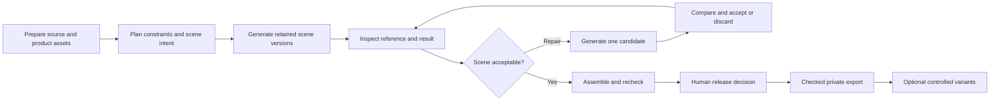

# Viraldy Smart Remake V2 — gap analysis and implementation priorities

Date: **2026-11-24**. Baseline: HEAD `b68d34dc60c076a33ef3f9718b89e60d64047f39` **plus pre-existing working-tree changes**. See [audit scope](VIRALDY_CURRENT_STATE_AUDIT.md#evidence-scope-and-interpretation). This document recommends work; no V2 implementation was performed.

Concurrent Kie frontend/config/test changes appeared during final verification. They are unfinished work at the recorded observation boundary, not an additional qualified generation route. See [source drift and citation scope](VIRALDY_CURRENT_STATE_AUDIT.md#concurrent-source-changes-during-final-verification). Provider expansion remains subject to the same capability, privacy, recovery and evidence gates below.

## Prioritization rules

P0 completes or protects the existing workflow and establishes evidence. P1 adds measured quality and editing depth to that workflow. P2 broadens distribution, asset management and variants after P0/P1 evidence is available. Complexity is relative engineering scope (S/M/L/XL), not a delivery estimate. Technical risk is the uncertainty of implementing the improvement safely. Seller value and competition relevance are **design hypotheses**, not measured conversion results or researched competitor claims.

The status column refers to current source: implemented means connected code, WIP means pre-existing uncommitted implementation, partial means the target promise is incomplete. It does not certify production readiness.

## Source evidence register

| ID | Exact current implementation evidence |
| --- | --- |
| E01 | `compile_request` and `_duration`, [service.py:75](../../apps/backend/src/viraldy/modules/smart_remake/service.py#L75), [service.py:87](../../apps/backend/src/viraldy/modules/smart_remake/service.py#L87); internal `SceneMap`, [schemas.py:364](../../apps/backend/src/viraldy/modules/smart_remake/engine/schemas.py#L364). |
| E02 | Compile orchestration and returned artifact labels, `compile_smart_remake`, [compile_service.py:72](../../apps/backend/src/viraldy/modules/smart_remake/engine/compile_service.py#L72), [compile_service.py:190](../../apps/backend/src/viraldy/modules/smart_remake/engine/compile_service.py#L190). |
| E03 | Initial render passes only scene capture, [service.py:231](../../apps/backend/src/viraldy/modules/smart_remake/service.py#L231); regeneration `record_task` callback, [repair_service.py:466](../../apps/backend/src/viraldy/modules/smart_remake/repair_service.py#L466); provider task callback, [render_orchestrator.py:389](../../apps/backend/src/viraldy/modules/smart_remake/engine/render_orchestrator.py#L389). |
| E04 | Legacy final writer always called, [render_orchestrator.py:517](../../apps/backend/src/viraldy/modules/smart_remake/engine/render_orchestrator.py#L517); local/R2 writers, [storage.py:15](../../apps/backend/src/viraldy/modules/smart_remake/engine/storage.py#L15), [storage.py:41](../../apps/backend/src/viraldy/modules/smart_remake/engine/storage.py#L41); static mount, [main.py:87](../../apps/backend/src/viraldy/api/main.py#L87). |
| E05 | `RepairRepository.project/start`, [repair_repository.py:18](../../apps/backend/src/viraldy/modules/smart_remake/repair_repository.py#L18), [repair_repository.py:47](../../apps/backend/src/viraldy/modules/smart_remake/repair_repository.py#L47); `begin_render`, [repair_service.py:268](../../apps/backend/src/viraldy/modules/smart_remake/repair_service.py#L268); JSONB models, [models.py:15](../../apps/backend/src/viraldy/modules/smart_remake/models.py#L15); [migration 0023](../../apps/backend/alembic/versions/0023_smart_remake_scene_repair.py#L1). |
| E06 | `repair`, [repair_service.py:403](../../apps/backend/src/viraldy/modules/smart_remake/repair_service.py#L403); `_compose`, [repair_service.py:584](../../apps/backend/src/viraldy/modules/smart_remake/repair_service.py#L584); `accept`, [repair_service.py:641](../../apps/backend/src/viraldy/modules/smart_remake/repair_service.py#L641); `check`, [repair_service.py:711](../../apps/backend/src/viraldy/modules/smart_remake/repair_service.py#L711). |
| E07 | ProductLock, [schemas.py:111](../../apps/backend/src/viraldy/modules/smart_remake/engine/schemas.py#L111); ReferenceAnalysis, [schemas.py:290](../../apps/backend/src/viraldy/modules/smart_remake/engine/schemas.py#L290); preserve-list truncation, [prompt_compressor.py:269](../../apps/backend/src/viraldy/modules/smart_remake/engine/prompt_compressor.py#L269), [prompt_compressor.py:297](../../apps/backend/src/viraldy/modules/smart_remake/engine/prompt_compressor.py#L297). |
| E08 | Caller-supplied compile JSON, [router.py:82](../../apps/backend/src/viraldy/modules/smart_remake/router.py#L82); manual render checks, [service.py:186](../../apps/backend/src/viraldy/modules/smart_remake/service.py#L186), [_assert_render_input:43](../../apps/backend/src/viraldy/modules/smart_remake/engine/render_orchestrator.py#L43). |
| E09 | Technical-only checker, [repair_media.py:24](../../apps/backend/src/viraldy/modules/smart_remake/repair_media.py#L24); original scene auto-activation, [repair_service.py:378](../../apps/backend/src/viraldy/modules/smart_remake/repair_service.py#L378); signed download presentation, [repair_service.py:168](../../apps/backend/src/viraldy/modules/smart_remake/repair_service.py#L168). |
| E10 | Current video generation/product upload, [render_orchestrator.py:367](../../apps/backend/src/viraldy/modules/smart_remake/engine/render_orchestrator.py#L367); regeneration removes source frames, [repair_service.py:452](../../apps/backend/src/viraldy/modules/smart_remake/repair_service.py#L452); [provider report](MODEL_PROVIDER_CAPABILITY_AUDIT.md). |
| E11 | Creative structure normalization and strategy mapping, [creative_router.py:143](../../apps/backend/src/viraldy/modules/smart_remake/engine/creative_router.py#L143), [creative_router.py:209](../../apps/backend/src/viraldy/modules/smart_remake/engine/creative_router.py#L209). |
| E12 | Cut expansion count defect, [source_shot_detector.py:50](../../apps/backend/src/viraldy/modules/smart_remake/engine/source_shot_detector.py#L50), [source_shot_detector.py:163](../../apps/backend/src/viraldy/modules/smart_remake/engine/source_shot_detector.py#L163); pacing instruction, [prompt_compressor.py:281](../../apps/backend/src/viraldy/modules/smart_remake/engine/prompt_compressor.py#L281). |
| E13 | Smart Remake route inputs, [router.py:39](../../apps/backend/src/viraldy/modules/smart_remake/router.py#L39); other generation rights helper, [generation/service.py:341](../../apps/backend/src/viraldy/modules/generation/service.py#L341); deletion order, [deletion/policy.py:17](../../apps/backend/src/viraldy/modules/deletion/policy.py#L17). |
| E14 | Studio route and state, [smart-remake-route.tsx:49](../../apps/web/src/features/smart-remake/routes/smart-remake-route.tsx#L49), [use-remake-studio.ts:30](../../apps/web/src/features/smart-remake/lib/use-remake-studio.ts#L30); latest-project localStorage, [use-remake-studio.ts:120](../../apps/web/src/features/smart-remake/lib/use-remake-studio.ts#L120); [UI architecture report](VIRALDY_ARCHITECTURE_CURRENT.md). |
| E15 | Candidate review and restore, [remake-version-review.tsx:10](../../apps/web/src/features/smart-remake/components/remake-version-review.tsx#L10); eligibility helper, [remake-review.ts:3](../../apps/web/src/features/smart-remake/lib/remake-review.ts#L3); [remake-player.tsx](../../apps/web/src/features/smart-remake/components/remake-player.tsx#L1). |
| E16 | [Experiment evidence inventory, exact offline test command and missing raw records](EXPERIMENT_EVIDENCE_AUDIT.md); [existing evaluation README](../../evaluation/README.md#L1). |
| E17 | Ephemeral assets, input boundaries, authz and export controls traced in [SECURITY_RIGHTS_AUDIT.md](SECURITY_RIGHTS_AUDIT.md). |

## Prioritized capability matrix

The two tables below are joined by ID. Together they provide current capability/status/evidence, missing capability, proposed change, dependencies, complexity, technical risk, seller value, competition relevance and acceptance criteria without making one unreadably wide table.

| ID / priority | Existing capability and status | Evidence | Missing capability → recommended V2 improvement | Required dependencies |
| --- | --- | --- | --- | --- |
| G01 / **P0** | Awaited initial render; WIP scene/operation retention and regeneration receipts | E03, E05, E06 | Initial submission lacks a durable task receipt/recovery path; two inactive slots cannot be incrementally accepted; long work remains HTTP-bound → finish durable initial render and repair lifecycle, with an owned render ID, per-scene receipts, reconciliation, staged or multi-slot acceptance and explicit ambiguous-submit state. | Review/apply migration 0023 in a test environment; existing processing-job/worker infrastructure; provider lookup/idempotency contract. |
| G02 / **P0** | Workspace route permissions/private S3 repair media; legacy public final copy | E04, E05, E13, E17 | Private ownership is incomplete; ephemeral references/deletion are detached → one workspace-owned artifact lifecycle, bounded media ingestion, authenticated/signed access, explicit retention/deletion and removal of public fallback from private runs. | Owned artifact IDs and keys; storage deletion integration; authorization tests; deployment storage/mount policy. |
| G03 / **P0** | ProductLock/reference/SceneMap dictionaries and prompt guards | E02, E07, E08, E12 | No trusted immutable compile/constraint artifact; cut enrichment defect and inconsistent duration boundaries → persist/validate the existing contracts, bind input hashes, fix measured-cut counting, make public duration/pacing rules consistent, record constraint omissions. | G02 ownership; runtime schema validation at real boundaries; compiler fixtures covering shot counts and preserve limits. |
| G04 / **P0** | WIP candidate acceptance, technical check, direct download; separate rights helper elsewhere | E06, E09, E13 | No final human release/rights/disclosure/export gate; failed active-version recheck leaves readiness unchanged → minimally bind source/product/music/person rights attestations and human release to the exact assembly hash, and invalidate affected readiness/approval when dependencies change; keep technical pass separate from approval. | G02/G03 artifact identity; permission policy; source/claim records; actor/time/reason decision record. |
| G05 / **P0** | Generic evaluation infrastructure, 51 selected offline tests, unlinked local media | E16 | No reproducible Smart Remake B0/B1/B2/ablation/rating/cost bundle → define baselines and capture paired raw evidence, failures and provider receipts before asserting quality improvements. | Frozen reviewed source/config; rights-cleared inputs; G01 receipts; explicit authorization for any paid qualification. |
| G06 / **P1** | Technical checker and coarse motion/structure intent | E07, E09, E16 | No semantic Inspector → add typed time-localized findings, deterministic output facts first, then calibrated product/structure checks and human adjudication. | G03 constraints; G05 labels/calibration; owned output frames; independent checker/version records. |
| G07 / **P1** | WIP prompt planner and candidate comparison/history | E14, E15 | No reference-result comparison after restore or findings workflow → extend existing studio with persistent reference playback, finding-linked scene selection and current/candidate/reference views. | G02 reference retention; G06 findings; existing synchronized player. |
| G08 / **P1** | Creative strategy normalization; fixed provider chosen for whole render | E10, E11 | No capability/quality-based per-scene route → introduce a small explicit routing policy only for already-qualified generation/reuse operations, with reason and fallback record. | G05 route evidence; G06 failure taxonomy; model capability receipts and budget policy. |
| G09 / **P1** | Eight-second scene regeneration and reuse of other active scenes | E06, E10 | Repair granularity is render units, not every source shot; no verified edit/V2V adapter → expose true repair scope and add finer segmentation only where measured benefit justifies it. | G03 normalized source/output mapping; G05 repair evidence; provider capability qualification. |
| G10 / **P1** | Scene versions with parent and usedByRevision; mutable current JSONB/final key | E05, E06, E15 | No immutable full assembly manifest/history → persist ordered selected-version IDs, media hashes, checks and release per assembly; allow exact historical assembly restoration. | G01/G02 durable media and schema migration; G04 approval invalidation. |
| G11 / **P1** | Generic product/assets and browser-local library | E13, E14, E17 | No Smart Remake linked product/character/rights registry → add minimum versioned references to existing assets/products, source license/consent scope and expiry; avoid a parallel unconnected asset store. | G02/G04 ownership/rights; existing asset/product versioning; retention revocation behavior. |
| G12 / **P1** | Local concat, audio mux and downloadable final | E06, E09, E10 | No checked channel export preset/manifest → first support one explicit export preset with server-side codec/duration/aspect/audio checks and disclosed approval/lineage. | G04 release gate; G10 assembly manifest; deterministic encoding/probing. |
| G13 / **P2** | Single-plan compile/render building blocks | E01, E02, E14 | No Ad Multiplier variants/batch control → introduce bounded hook/CTA variants with shared approved scenes and traceable changed constraints. | G05 baseline evidence; G08 routing; G10 lineage; aggregate cost limits. |
| G14 / **P2** | Generic evaluation contracts and UI primitives | E14, E16 | No Experiment Lab workflow → add an experiment view over the evidence pipeline after CLI/offline results reproduce; include failures and blinded rating assignments. | G05 stable data contract; identity/blinding rules; G11 rights-cleared dataset links. |
| G15 / **P2** | Native-audio instructions and optional source-music extraction | E06, E10, E13 | No qualified dubbing/localization, audio rights-aware variant export → expand languages/ratios/distribution one qualified preset at a time. | G04 rights; G05 category/language evidence; G12 preset verification. |

| ID | Complexity | Technical risk | Seller value | Competition relevance hypothesis | Acceptance criteria |
| --- | --- | --- | --- | --- | --- |
| G01 | L | High: paid-task ambiguity, restarts and races | High: retain completed work and avoid unnecessary paid retries | Reliable recovery and selective spend | Kill/restart after recorded submission; reconcile same provider task; no second generation for known task; explicit unresolved state if receipt is unknown; recover a project with two inactive slots by staged or atomic selection; two-scene repair changes one selected scene; retry/accept is idempotent; stale revision rejected. |
| G02 | L | High: multiple output stores and orphan cleanup | High: private product/source/output handling and reliable deletion | Trustworthy handling of merchant assets | Unauthorized/cross-workspace URLs and IDs fail; no private run creates a public legacy copy; ownership checked on ephemeral IDs; oversized uploads stop before full memory ingestion; workspace/project deletion removes DB/objects and invalidates access; failed cleanup is recorded/retried. |
| G03 | M–L | Medium–High: validation can reject tolerated payloads | High: predictable product/source intent | Explainable, inspectable remake requirements | Render references owned compile ID+hash; changed product requires new analysis; malformed nested artifacts fail; detected 4→8 shot example enriches correctly; 8/16 policy consistent; more than five must-preserve items are retained or explicitly reported unsupported; slow pacing has no contradictory unconditional fast instruction. |
| G04 | M–L | High: approval state and revocation | High: controlled release and traceable asset usage | Approval evidence attached to exact delivered media | Generation checks applicable rights/consent scope; music extraction needs a permitted source; technical pass does not approve; pending/failed/unknown blocking requirements prevent export; authorized actor records decision; repair and failed dependency rechecks invalidate affected final approval/readiness; denied exports are tested. |
| G05 | M–L | Medium: provenance and experimental confounds | High: know when remake/repair improves outputs and spend | Defensible measured quality/cost, if later demonstrated | Manifest and run receipts link hashed inputs/config/code/output; B0/B1/B2 definitions frozen before runs; one-factor ablations recorded; all attempts/failures retained; blinded raw ratings and agreement reported; actual latency/usage separated from estimates; replay of scoring succeeds offline. |
| G06 | L–XL | High: semantic uncertainty and false confidence | High: locate wrong products or failed scenes before release | Actionable evidence instead of an opaque overall score | Finding includes type, interval, constraint/media/checker IDs, score/threshold and evidence frame; unsupported checks return unknown; product/structure checks evaluated on held-out labels with error rates; deterministic checks reproducible; human override reason persisted. |
| G07 | M | Medium: media synchronization/restored state | High: understand what changed and fix it quickly | One cohesive review workflow | Reopen project with reference/current/candidate; aligned playback and usable narrow-screen controls; click finding selects correct interval/render unit; missing source/expired URL handled; browser tests cover plan→repair→accept→restore. |
| G08 | L | High: strategy quality is not model-name knowledge | High when evidence shows fewer failures | Capability-aware selection with visible reasons | Each route declares actual accepted inputs and qualified outputs; unsupported V2V/object replacement routes cannot be selected; routing reason/fallback/cost recorded; held-out results compared with fixed-provider baseline; approved reuse performs no generation. |
| G09 | L | High: temporal continuity and provider granularity | Medium–High: repair only the defective region | Reduced rework where demonstrated | UI/API state eight-second scope today; narrower repair only after qualified mapping; untouched scene media hashes unchanged; join continuity and final checks rerun; no claim of editing old video when the adapter only regenerates. |
| G10 | M | Medium: state/lineage consistency | High: safe comparison and rollback | Reproducible previous delivery state | Every assembly revision stores complete ordered scene-version manifest and final hash/key; exact previous assembly can be selected; candidate/recheck changes do not erase prior receipts; rollback invalidates stale release decisions. |
| G11 | L | High: consent/rights revocation and media retention | Medium–High: reuse trusted products/characters | Consistent asset identity across projects | Product/character uses reference immutable asset version; consent/license scope/expiry recorded; revoked/expired assets block new generation/export; cross-workspace lookup denied; previous usage remains auditable without leaking deleted media. |
| G12 | M | Medium: encoding and permission drift | High: deliver a usable approved ad | Predictable delivery constraints | One named preset produces probed matching dimensions/codec/fps/audio/duration; only approved assembly exports; export manifest includes disclosure/provenance/preset/version; no static/public bypass. |
| G13 | L | High: multiplied cost and misleading variant comparisons | Medium initially | Efficient variant creation after quality is proven | Bounded variant count/budget; changed constraints explicit; unchanged approved scenes reused by hash; lineage and per-attempt outcomes/cost retained; final review per variant. |
| G14 | M–L | Medium: UI can hide poor evidence | Medium initially | Accessible experiment evidence | UI displays raw attempts, failures, ratings and uncertainty from G05; fixture/live distinction persistent; downloadable manifest reproduces reported result; no leaderboard from synthetic metrics. |
| G15 | L–XL | High: speech, claims and format quality vary | Medium until category/channel demand established | Qualified expansion beyond one format | Each new language/channel has rights-cleared test cases, audio/claim review, measured quality and export preset; source soundtrack is not reused merely because it can be extracted. |

## First vertical slice and implementation sequence

### Step 1 — finish the owned render lifecycle

The first implementation ticket should be **“Persist initial Smart Remake provider tasks and recover the retained two-scene project.”** It should extend the existing initial-render path to create a durable owned render/operation record, wire initial task receipts into persistence, and make long work resumable through the established worker/job infrastructure. Preserve the working-tree repair API contract where reasonable; do not build a second scene-repair subsystem.

Its proof sequence is: compile an owned plan → start render → record task receipt → interrupt after submission → reconcile the same task → retain both scenes → generate a candidate for one scene → reject/accept with revision/idempotency checks → restore a historical scene → reassemble and verify. A provider-side idempotency key or equivalent lookup is necessary to close the crash window between remote acceptance and local task-ID persistence; if unavailable, surface **unknown/pending reconciliation** rather than guaranteeing exactly-once paid execution.

The slice is not ready for external release until G02's private-output/ownership/deletion protections and G04's minimal release/export checks are connected. These are release conditions for the same workflow. They should not be interpreted as permission to defer a known public-copy path until after seller assets are used.

### Step 2 — qualify contracts and measurements

Complete G03 runtime binding/validation and the confirmed cut-count fix with offline regression coverage. Reuse current technical checks as the deterministic baseline and retain their coverage labels. Complete G05's manifest/receipts and explicitly define B0/B1/B2; do not assign labels to past unlinked files retroactively.

Recommended experiment ordering: software fixture replay → real local FFmpeg/media tests → database/storage and workspace isolation integration → browser journey → separately authorized small live-provider run. Keep provider/model/config/input hashes fixed for comparisons, and preserve every failed attempt. No quality target number is invented by this audit; set thresholds from a labeled pilot before using them as release criteria.

### Step 3 — add the smallest useful Inspector

Persist findings linked to media hashes and source/output time intervals, initially for deterministic facts and manually recorded semantic failures. Add product identity and structure checks in that schema only after the labeled evaluation harness is operational. Reuse existing scene selection, candidate review and comparison components so a finding can lead directly to a repair and a new assembly check.

Do not start with an all-purpose “quality score.” Product resemblance, shot structure, physical action, claims and consent have different evidence requirements. A checker that cannot assess one must return unknown and route the decision to a human or an explicit release policy.

## Cohesive seller workflow

Extend the current three-step studio into one project lifecycle:

This is a **recommended workflow**, not the current architecture diagram. Keep Planner and scene timeline inside Plan; comparison, Inspector findings, Scene Fix and Version Compare inside Result. My Assets supplies owned/versioned inputs to Prepare. Technical Trace is a project detail drawer backed by artifact/task/check receipts. Smart Export follows a release decision. Ad Multiplier creates child variants of an approved assembly. Experiment Lab reads the same receipts in a separate expert view, rather than adding an unrelated generation path.

Reuse the current `RemakeJourney`, `RemakeStoryboard`, `RemakeOutput`, `RemakePlayer` and `RemakeVersionReview`. Maintain the explicit fixture/demo labels and the review UI's distinction between technical checks and product/creative quality. Persist enough reference context that reopening a project can still support a useful comparison; local object URLs and a last-project localStorage key are insufficient for that promise (E14/E15).

## Gates that prevent premature expansion

| Before expanding | Evidence required |
| --- | --- |
| Adding more generation strategies | Actual adapter input/output contract and replayable route benchmark; source text intent is not proof of motion transfer. |
| Claiming higher product fidelity | Paired held-out outputs, raw blinded ratings and calibrated checker error rates. |
| Claiming repair reduces cost/latency | Actual first-render + retry + repair + inspection + assembly costs/timestamps, with failures included. |
| Enabling Ad Multiplier | Stable single-project recovery, rights/release state, budget bounds and variant lineage. |
| Enabling wider export | Backend permission/approval/preset checks, no public fallback, repeatable technical validation. |
| Calling Experiment Lab reproducible | Hashed manifests, exact code/config/model receipts and raw per-attempt/per-rater evidence that reproduces aggregates. |

## Open decisions and blockers

1. Which uncommitted repair/studio state will become the reviewed baseline, and is migration 0023 applied anywhere? Establish this before claiming a deployed capability.
2. Can each provider deduplicate or look up an ambiguous initial submission? If not, recovery must explicitly retain uncertainty and require reconciliation.
3. What evidence establishes target product/person/music/source rights, and who owns the final release decision? These belong in backend contracts before reusable registry expansion.
4. What category/language/source-complexity distribution represents sellers' actual needs? It determines the pilot dataset, routing and Inspector thresholds.
5. Where are the previously reported experiment outputs/ratings/logs, if they exist outside this repository? Their absence here blocks verification, not documentation of the missing evidence.
6. Is literal source structure required or may the planner soften impossible actions? Record the chosen contract and unsupported constraints; do not silently promise both.

The recommended release order is **G01–G05 as one qualified vertical slice, then G06/G07/G10 for useful inspection and history, then evidence-driven routing/registry/export expansion, then variants and Experiment Lab UI**.
