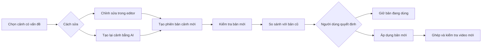

# Smart Remake — sửa hoặc tạo lại cảnh lỗi có kiểm soát

Bản đề xuất gốc ngày 2026-11-24. Phần thiết kế và audit bên dưới được giữ làm lịch sử; trạng thái runtime KIE và **Timeline v2 đã triển khai ngày 2026-11-25** được ghi ở cuối tài liệu. Các hạng mục canvas/typography chưa có trong phần bàn giao không được coi là đã triển khai.

**Cập nhật hiện hành:** phần “Veo Lite, ảnh OpenAI và nhóm sinh video” cuối tài liệu thay thế cấu hình Fast và quy tắc một cảnh/một task của các snapshot trước. Cấu hình ảnh mới nhất là [Sunburst, quality max, complexity high](#cấu-hình-ảnh-sunburst-max-high), thay cho chính sách Flare/low ban đầu. Đợt cập nhật này ưu tiên desktop theo yêu cầu người dùng; bằng chứng kiểm tra của từng đợt được giữ riêng.

Định hướng sản phẩm mới nhất: [AI Product, Business và Seller](../product/smart-remake-product-brief.md). Trọng tâm là editor ý định và vòng tạo lại riêng cảnh; các hạng mục canvas/typography là nhánh bổ sung. Estimate 23–35 ngày công phía dưới bao gồm gói hậu kỳ rộng đã đề xuất trước đó, chưa phải estimate chốt cho scope chính đã điều chỉnh.

UX contract xuyên suốt: xem phần “Thiết kế trải nghiệm seller từ lúc vào feature” trong product brief. Entry ba bước Chuẩn bị → Duyệt kịch bản → Video của bạn; repair/compare là nhánh trong kết quả. Dùng contract này làm nền implementation UI, thay vì mở ngay workspace canvas khi seller vừa vào.

Yêu cầu thiết kế đã chốt theo người dùng: nhiều tính năng hữu ích, dễ hiểu, dễ dùng, trực quan, layout đủ chi tiết để implement; chỉ chọn thư viện miễn phí có cộng đồng sử dụng lớn và đúng nhu cầu sửa cảnh. Các SDK editor thương mại không thuộc phương án triển khai.

## Làm rõ thao tác sửa và xuất video

Luồng chính là sửa nội dung/yêu cầu của cảnh rồi render hoặc generate lại cảnh đó, ghép với các cảnh đang dùng và kiểm tra output mới. Editor mặc định cần phục vụ sửa mô tả hình ảnh, hành động, góc quay, lời thoại/nội dung chữ mong muốn và reference/điều kiện giữ nguyên. Chỉnh form hoặc preview không tự làm thay đổi file MP4 đã có.

Phân biệt ba thao tác:

- Sửa hình ảnh/hành động hoặc chữ đã nằm trong pixel của video AI: yêu cầu AI tạo lại cảnh; chưa hứa sửa chính xác từng chữ hoặc giữ nguyên mọi pixel còn lại.
- Sửa lớp chữ/ảnh hậu kỳ do Viraldy quản lý: có thể preview bằng overlay, nhưng xuất video vẫn cần render/composite media mới bằng worker. Muốn sửa lớp cũ sạch sẽ cần giữ clip nền và dữ liệu layer, tránh chồng chữ lên bản đã bake.
- Chỉ sửa yêu cầu/prompt: phải có nút tạo lại cảnh; không gọi thao tác lưu form là đã sửa video.

Mockup chỉnh chữ trước đó chỉ minh họa nhánh overlay hậu kỳ được đề xuất, chưa phải khả năng sửa chữ có sẵn trong video hiện tại. Các tính năng typography/layers/canvas dưới đây thuộc nhánh hậu kỳ bổ sung; không phải điều kiện bắt buộc của vòng sửa cảnh bằng AI. Ưu tiên prototype chính chuyển sang chọn lỗi → sửa yêu cầu cảnh → tạo lại → so sánh → kiểm tra → áp dụng.

Code hiện có nhánh FFmpeg text overlay nhưng `_text_overlays` mặc định tắt nếu không bật `SMART_REMAKE_RENDER_TEXT_OVERLAYS`; khả năng thực thi còn phụ thuộc filter `drawtext` và đường render. Không suy ra ứng dụng hiện đã hỗ trợ editor chữ/export typography đầy đủ từ nhánh này.

## Mục tiêu và giả định

Người dùng chọn đúng cảnh có vấn đề, sửa bằng editor hoặc yêu cầu AI tạo lại cảnh đó, xem kết quả kiểm tra trên phiên bản mới và chủ động áp dụng vào video. Cảnh đang tốt được giữ nguyên; bản cũ luôn có thể xem lại và khôi phục trong thời hạn lưu trữ.

Giả định cho MVP:

- Editor nằm trong Viraldy, có bộ công cụ phong phú theo từng cảnh; ưu tiên công cụ giúp hoàn thành vòng sửa → kiểm tra → duyệt.
- Contract v1 tại thời điểm lập kế hoạch: video dọc 9:16, tổng 8 hoặc 16 giây, mỗi cảnh 8 giây. Timeline v2 hiện tách clip AI thô 8 giây khỏi đoạn sử dụng có độ dài theo cảnh nguồn; xem phần bàn giao cuối tài liệu.
- “Cảnh lỗi” gồm lỗi tạo video thất bại, lỗi kỹ thuật trên output, AI gợi ý vấn đề có bằng chứng và người dùng tự đánh dấu. Bốn trường hợp phải có nhãn phân biệt.
- Chỉ lập kế hoạch; chưa cài thư viện, gọi job AI có phí hoặc sửa runtime.

Tiêu chí thành công quan trọng nhất: với video 16 giây có hai cảnh, sửa cảnh 2 phải giữ media của cảnh 1, tạo bản cảnh 2 mới, kiểm tra bản mới và chỉ thay video đang dùng sau khi người dùng chọn áp dụng.

## Hiện trạng đã kiểm tra trong repository

| Thành phần | Hiện có | Khoảng trống cần xử lý |
| --- | --- | --- |
| Smart Remake UI | Upload, compile, xem kịch bản/prompt, render, phát video cuối | Chưa có chọn cảnh lỗi, editor media, lịch sử bản cảnh, vòng QA → duyệt |
| API | `/health`, `/compile`, `/render` | Chưa có contract repair một cảnh hoặc accept bản cảnh |
| Scene map | 1–2 cảnh, `displayOrder`, 8 giây/cảnh | Chưa có ID cảnh nội bộ bền vững; cần tách ID nội bộ khỏi ID provider |
| Render | Có vòng render các cảnh rồi ghép; có retry một số lỗi provider | Render lại một cảnh chưa phải operation độc lập; retry provider không đồng nghĩa sửa lỗi chất lượng |
| Frontend result | API type có `projectId`, `videoId`, `sceneIds` tùy chọn | `SmartRemakeRenderState` chỉ giữ `finalVideoUrl` và `status` |
| Version | `SceneMap.version`, compiler/schema versions | Chưa phải lịch sử immutable của media hoặc edit |
| Tài nguyên | Có output storage và cleanup | Source frames, nhạc trích xuất có thể bị dọn sau render; cần giữ dependency để sửa về sau |
| UGC Review | Revision, so sánh resolved/still open/new findings; seek đến evidence | Có thể tái sử dụng cách tổ chức revision và UI; chưa thay thế được QA kỹ thuật/product/continuity |

Bằng chứng chính:

- `apps/web/src/features/smart-remake/routes/smart-remake-route.tsx`
- `apps/web/src/features/smart-remake/lib/smart-remake-render.ts:9-24`
- `apps/web/src/shared/api/smart-remake.ts:32-45`
- `apps/backend/src/viraldy/modules/smart_remake/router.py`
- `apps/backend/src/viraldy/modules/smart_remake/engine/schemas.py:348-377`
- `apps/backend/src/viraldy/modules/smart_remake/engine/render_orchestrator.py:135-170,294-392`
- `apps/backend/src/viraldy/modules/smart_remake/engine/asset_cleanup.py:49-69`
- `apps/web/src/features/ugc-review/components/revision-comparison.tsx`

Lưu ý cho triển khai: frontend hiện ưu tiên video demo nếu file demo tồn tại, đồng thời hiển thị tiến độ dựa trên timer. Luồng sửa thật cần tách demo/live rõ ràng và lấy trạng thái job từ server. Không coi demo là bằng chứng end-to-end cho provider.

## Luồng trải nghiệm đề xuất

### Bố cục desktop

| Trái: danh sách cảnh | Giữa: preview | Phải: sửa và kiểm tra |
| --- | --- | --- |
| Thumbnail, Cảnh 1/2, mốc thời gian | Video dọc 9:16, play/pause, loop cảnh | Tabs: Vấn đề / Chỉnh sửa / Tạo lại / Phiên bản |
| Nhãn: Chưa kiểm tra / Cần sửa / Cần xem lại / Đạt | Bật so sánh Bản đang dùng ↔ Bản mới | Lỗi kèm timestamp, lý do, mức độ, bằng chứng |
| Bản đang dùng, trạng thái xử lý | Timeline gọn, marker lỗi có thể click | CTA: Xem trước / Tạo bản mới / Kiểm tra lại / Áp dụng |

Thanh dưới: trạng thái lưu nháp, thông tin chi phí nếu có, tiến trình job, nút áp dụng gắn với phiên bản đang xem.

Mobile: preview phía trên, danh sách cảnh cuộn ngang và drawer điều khiển. Có trường nhập số cho vị trí/kích thước để không phụ thuộc thao tác kéo. Không dùng màu làm dấu hiệu trạng thái duy nhất; hỗ trợ focus, keyboard, nhãn nút và thông báo tiến độ.

### Chọn cảnh và nhận diện lỗi

- Click cảnh hoặc marker để preview đúng đoạn. Timestamp cảnh dùng local time và có thể đổi sang thời gian toàn video.
- Hiển thị rõ “Bạn đánh dấu” hoặc “Hệ thống phát hiện”; nếu chưa có bằng chứng thì không tự gắn kết luận đã xác nhận.
- Nếu job cảnh thất bại, hiển thị lỗi tạo cảnh và hành động thử lại; không yêu cầu preview media chưa tồn tại.
- Cho phép người dùng chọn lý do: sai sản phẩm, chữ khó đọc/sai, chuyển động lỗi, âm thanh hoặc vấn đề khác.

### Hai nhánh sửa

**Editor MVP:** chỉnh lớp chữ/ảnh do Viraldy quản lý, font/kích thước/vị trí/thời gian xuất hiện, crop/reframe có giới hạn và âm lượng/mute nếu có audio. Có undo/redo, reset, safe-area overlay và lưu nháp khi chuyển cảnh. Preview không tạo job AI; xuất bản cảnh mới chạy job render media.

Chữ đã cháy vào video hoặc hình sản phẩm bị méo không thể được “sửa chữ/sửa hình” bằng thao tác overlay thông thường. UI phải phân biệt lớp sửa được và nội dung đã render; hướng người dùng sang tạo lại cảnh khi cần. Đổi prompt cũng tạo media mới, không phải chỉnh trực tiếp media cũ.

MVP không đổi thời lượng cảnh, reorder hoặc trim làm thay đổi tổng thời lượng. Nếu thêm trim sau này, phải thiết kế lại duration/continuity/assembly và thời gian audio.

**Tạo lại cảnh:** bắt đầu từ mô tả lỗi và prompt cảnh hiện tại; hiển thị “Giữ nguyên” và “Thay đổi”. Giữ product identity, reference được phép, tỷ lệ, thời lượng và style của dự án. Người dùng chỉnh mục tiêu sửa/copy/shot direction trong phạm vi cho phép. Server validate prompt sửa theo product lock và chỉ gửi cảnh được chọn tới provider.

Mỗi lần tạo một candidate. Hiển thị số lần đã thử và ước lượng chi phí nếu backend có dữ liệu; nếu không có thì báo chưa có ước lượng. Thực thi hạn mức lần thử/ngân sách trên server. Seed, reference conditioning và các control nâng cao chỉ hiện khi adapter/model thực sự hỗ trợ; không hứa tái lập tuyệt đối bằng seed.

### Kiểm tra và duyệt phiên bản mới

- QA gắn với đúng `sceneVersionId` + media hash + version bộ kiểm tra và snapshot product lock/reference. Kiểm tra continuity còn gắn với version cảnh lân cận hoặc manifest hash; đổi ngữ cảnh này phải đánh dấu kết quả continuity cũ hết hiệu lực.
- Kết quả: vấn đề đã sửa, vấn đề còn lại, vấn đề mới và các mục chưa kiểm tra được.
- Kiểm tra kỹ thuật: giải mã, kích thước/tỷ lệ, thời lượng, khung đen/đứng bất thường, audio theo yêu cầu thực tế.
- Kiểm tra nội dung: fidelity sản phẩm so với reference, chữ/OCR khi cần, nội dung được yêu cầu và continuity với cảnh trước/sau. Đây là các hạng mục cần đánh giá chất lượng, không cam kết AI luôn phát hiện đúng.
- Thiếu bằng chứng/provider QA lỗi → “Cần xem lại”; không biến thành “Đạt”. Bản kỹ thuật không hợp lệ bị chặn áp dụng. Finding nội dung chưa chắc chắn cần người dùng xem và xác nhận, lưu lại quyết định.
- Bản render xong chưa tự trở thành bản đang dùng. Người dùng có thể giữ cũ, thử lại hoặc áp dụng candidate.
- Khi áp dụng, ghép đúng manifest cảnh, kiểm tra video ghép, rồi mới chuyển con trỏ video đang dùng. Nếu ghép/QA thất bại, giữ video hiện tại.
- So sánh A/B đồng bộ theo thời gian tương đối; chỉ phát audio của một bản. Cho xem thêm đoạn nối ở ranh giới cảnh.

## Thư viện và quyết định UI/UX

Stack thực tế hiện tại: React 19, TanStack Router/Start, Vite, Tailwind, Radix, TanStack Query, Zustand; không giả định ứng dụng là Next.js.

| Lựa chọn | Dùng vào việc gì | Đề xuất |
| --- | --- | --- |
| Radix + shared UI hiện có | Tabs, dialog, slider, tooltip, keyboard/focus | Dùng ngay; giữ design tokens của app. [Accessibility docs](https://www.radix-ui.com/primitives/docs/overview/accessibility) |
| `react-resizable-panels` đã cài | Workspace ba vùng co giãn | Dùng ngay, có layout mobile riêng |
| TanStack Query + Zustand đã cài | Query job/version trên server; state editor/undo cục bộ | Dùng ngay; DB là nguồn sự thật, không dùng local store làm lịch sử media |
| `konva` + `react-konva` | Selection, kéo/resize text/image, khung crop, snap guides và annotation | Chọn làm nền editor. MIT, không cần license key. Pin bản có peer dependencies khớp React/ReactDOM 19.2 hiện có; không chỉ dựa vào cùng major. [Konva license](https://github.com/konvajs/konva/blob/master/LICENSE), [react-konva license](https://github.com/konvajs/react-konva/blob/master/LICENSE), [React docs](https://konvajs.org/docs/react/index.html) |
| `wavesurfer.js` | Waveform, region và điểm vào/ra audio khi có track âm thanh | Bổ sung cho audio panel; BSD-3-Clause. Không dùng làm video timeline/export. [Docs](https://wavesurfer.xyz/), [License](https://github.com/katspaugh/wavesurfer.js/blob/main/LICENSE) |

Stack chốt: UI hiện có + HTML video + Konva cho editor theo cảnh; FFmpeg ở worker cho bản xuất. Radix, react-resizable-panels, TanStack Query, Zustand đều MIT: [Radix](https://github.com/radix-ui/primitives/blob/main/LICENSE), [Panels](https://github.com/bvaughn/react-resizable-panels), [Query](https://github.com/TanStack/query), [Zustand](https://github.com/pmndrs/zustand). Đây là các dự án có cộng đồng lâu năm và được dùng rộng rãi; GitHub stars chỉ là tín hiệu cộng đồng, không phải số người dùng. Giữ notices/license của dependency được pin.

Canvas preview và FFmpeg cùng đọc một edit schema có tọa độ chuẩn hóa, font/asset/timing cố định; không xuất video bằng ảnh chụp canvas. Cần kiểm tra preview/export khớp nhau trên test fixture. Dùng font có license cho phép phân phối; ưu tiên font hiện có nếu quyền sử dụng phù hợp.

[FFmpeg filters](https://ffmpeg.org/ffmpeg-filters.html) hỗ trợ các phép crop, overlay, drawtext, volume phục vụ hướng này. Chưa chọn ffmpeg.wasm làm đường render mặc định: tài liệu của thư viện ghi nhận hiệu năng thấp hơn FFmpeg native; nên giữ render dài/nặng ở worker hiện có. [Performance](https://ffmpegwasm.netlify.app/docs/performance/).

FFmpeg không có phí SDK nhưng license binary phụ thuộc cấu hình build/codecs; ghi lại build đang dùng theo [FFmpeg licensing](https://www.ffmpeg.org/legal.html). “Thư viện miễn phí” không làm mất chi phí AI provider, render compute hoặc object storage. Không thêm Remotion, IMG.LY hoặc SDK thương mại làm dependency bắt buộc. Không thêm nhiều engine canvas hoặc drag/drop cùng giải quyết một thao tác.

## Đặc tả UI/UX để implement

### Nguyên tắc hiển thị

1. Preview là trọng tâm; mọi thao tác sửa cho thấy kết quả tại cảnh đang chọn.
2. Người mới thấy tên việc bằng tiếng Việt: “Di chuyển chữ”, “Giữ hình sản phẩm”, “Tạo lại cảnh này”. Prompt, seed và thông số model nằm trong “Nâng cao”.
3. Nhiều công cụ nhưng mở theo ngữ cảnh: chọn text mới hiện font/outline/alignment, chọn ảnh mới hiện fit/crop/opacity. Không mở mọi thuộc tính cùng lúc.
4. Mỗi ngữ cảnh có một CTA chính. Lưu nháp tự động; thao tác có chi phí hoặc thay bản đang dùng phải là hành động riêng có nhãn rõ ràng.
5. Sáng tạo ở cách thao tác: click lỗi để nhảy đến frame, vùng safe area, guide căn chỉnh, so sánh đồng bộ, nhấn giữ xem bản trước. Giữ chrome yên, tránh motion trang trí cạnh video.

### Layout và kích thước

Giữ AppShell/design tokens hiện có: primary #ff385c, font stack Cereal/Inter/system của app, không tự thay font toàn sản phẩm. Dùng text 14px cho nội dung, 12px cho timestamp/metadata và 20–24px cho title; spacing theo bội số 4/8px. Bán kính control 10–12px, panel 12–16px; shadow chỉ cho phần nổi như popover.

- Desktop >=1280px: thu gọn app navigation vào icon rail khi vào editor; scene panel 224px (min 192/max 300), inspector 336px (min 300/max 420), preview chiếm phần còn lại. Giữ preview min 360px; không ép ba panel khi không đủ chỗ.
- 1024–1279px: scene rail nằm ngang phía trên timeline, preview + inspector hai cột. Inspector có thể đóng.
- 768–1023px: preview trên, timeline gọn dưới, inspector thành vùng bên dưới/Sheet; không thu nhỏ desktop theo tỷ lệ.
- <768px: một preview + một tác vụ tại một thời điểm, scene thumbnails cuộn ngang có nút chọn thay thế; công cụ mở trong drawer, action bar theo flow. Không để drawer che CTA/keyboard input.
- Thanh header khoảng 56–64px: back/project name, trạng thái lưu và job; không lặp các nút tạo lại ở nhiều vùng.
- Timeline 136–192px, có thể thu gọn: ruler, playhead, cảnh video cố định, track text/image và audio nếu tồn tại. Cuộn ngang chỉ trong timeline khi zoom, không tạo tràn ngang toàn trang.
- Preview tự fit 9:16 theo chiều cao khả dụng, nền trung tính; vùng kéo không bao phủ controls; chế độ A/B chỉ mở khi có hai bản và đủ không gian, màn nhỏ dùng toggle cùng playhead.
- Touch target mục tiêu 44px, contrast text >=4.5:1, focus rõ; trạng thái luôn có icon/nhãn ngoài màu. Tôn trọng reduced-motion.

### Bộ tính năng cho bản đầu tiên

| Nhóm | Tính năng | Cách dùng trực quan | Điều kiện nghiệm thu |
| --- | --- | --- | --- |
| Khám phá cảnh | Thumbnail, trạng thái, lọc cần sửa, timestamp, đánh dấu lỗi thủ công | Click cảnh/finding → chọn đúng cảnh và seek đúng frame | Marker không dùng nhầm thời gian nguồn và output |
| Playback | Play/pause, scrub, loop vùng/cảnh, playback speed chỉ cho preview, previous/next scene | Controls cạnh preview, timestamp luôn thấy | Không thay speed media xuất khi đổi playback speed |
| Layers | Text/image/logo, chọn, duplicate, hide, lock, xếp thứ tự trước/sau | Click canvas ↔ chọn layer tương ứng | Layer đang ẩn/khóa có trạng thái và control mở lại |
| Text | Sửa copy, font, size, weight, fill, stroke/background, alignment, timing | Chọn chữ → mở thuộc tính chữ | Tiếng Việt/font/timing preview và export khớp |
| Preset | 3–5 preset caption/CTA từ design tokens của app | Chọn preset thấy ngay preview, còn chỉnh tiếp được | Preset là dữ liệu nội bộ, không phụ thuộc thư viện trả phí |
| Transform | Move/resize/rotate overlay, căn giữa/cạnh, snap guide, nhập số, safe area | Drag handles + trường số thay thế | Tọa độ chuẩn hóa; safe area là hướng dẫn thiết kế, có version, không hứa luôn đúng mọi placement TikTok |
| Video framing | Fit/fill, crop/reframe và reset | Khung crop trên preview | Giữ duration và aspect ratio contract |
| Timeline | Zoom, playhead, marker, layer start/end, snap | Kéo biên layer hoặc nhập thời gian | Layer không vượt 0–8 giây; chưa đổi độ dài cảnh |
| Audio | Waveform khi có audio, volume/mute, fade in/out có giới hạn | Track chỉ hiện khi asset có audio | Bản không audio không bị báo lỗi trừ khi audioRequired |
| Tạo lại | Mục tiêu sửa, gợi ý có thể chỉnh, giữ nguyên sản phẩm/style, xem thay đổi | Form ngắn, advanced collapsed, CTA theo cảnh | Control chỉ xuất hiện khi provider hỗ trợ |
| Kiểm tra | Marker bằng chứng, resolved/open/new/unknown, kiểm tra lại | Chọn finding để xem frame và cách sửa gợi ý | Không auto-pass do thiếu bằng chứng; đổi context làm QA stale |
| Phiên bản | A/B đồng bộ, history, bản đang dùng, apply/rollback | Nhãn bản luôn thấy; compare không thay active | Apply ghép/QA thành công mới đổi active output |
| Độ tin cậy | Autosave, undo/redo, dirty draft, phục hồi reload, job resume | “Đang lưu / Đã lưu / Chưa lưu được” + Retry | Không mất draft khi đổi cảnh hoặc refresh sau save |

Các tính năng trên là scope bản đầu tiên có thể triển khai theo các đợt; không gọi một UI demo chưa nối backend là đã hoàn thành feature. OCR semantic QA và tạo lại dùng provider hiện có; không trình bày thư viện UI như khả năng tự phát hiện lỗi AI.

### Trạng thái và hành động chính

| Trạng thái | CTA chính | Trạng thái phụ/thoát |
| --- | --- | --- |
| Chưa có video | Tạo video đầu tiên | Hướng dẫn input tối thiểu |
| Có finding | Sửa cảnh này | Tự chỉnh / Tạo lại, seek bằng chứng |
| Đang chỉnh draft | Tạo bản đã chỉnh | Preview tức thì, undo/redo, báo autosave |
| Sẵn sàng tạo lại | Tạo lại cảnh này | Hiển thị cảnh, giới hạn, chi phí nếu có |
| Job đang chạy | Xem tiến trình | Cảnh cũ còn xem được; hủy chỉ khi provider hỗ trợ, giải thích semantics hủy theo dõi nếu khác |
| Có bản mới chưa QA | Kiểm tra bản mới | So sánh, giữ bản cũ |
| QA xong | Áp dụng bản này | Nếu còn finding cần xác nhận: ghi nhận review; technical failure chặn apply |
| Đang ghép | Xem tiến trình ghép | Bản hiện tại chưa đổi |
| Lỗi job/lưu/QA | Thử lại đúng bước lỗi | Giữ draft/candidate, lỗi có hành động cụ thể |
| Conflict/stale | Tải bản hiện tại | Giữ candidate, đối chiếu và kiểm tra lại khi cần |

Không dùng toast làm nơi duy nhất báo lỗi. Toast xác nhận ngắn; vấn đề cần xử lý nằm ngay ở panel liên quan. Empty states chỉ rõ thao tác tiếp theo. Keyboard: Space play/pause ngoài input, Cmd/Ctrl+Z undo, Shift+Cmd/Ctrl+Z redo, Escape bỏ chọn; không chặn phím khi đang nhập text hoặc ở form.

### Component và contract triển khai

Feature folder đề xuất tại `apps/web/src/features/smart-remake/`:

- `components/remake-workspace.tsx`: layout/responsive và orchestration UI.
- `components/scene-rail.tsx`, `scene-issues.tsx`: chọn cảnh/finding và điều hướng evidence.
- `components/scene-preview.tsx`, `scene-canvas.tsx`: HTML video + Konva overlays; không đặt job mutation trong canvas.
- `components/scene-timeline.tsx`, `layer-inspector.tsx`: timing, properties và accessibility alternatives.
- `components/scene-regenerate-panel.tsx`, `scene-version-comparison.tsx`, `scene-quality-results.tsx`.
- `lib/scene-edit-schema.ts`: Zod DTO có discriminated layer types, normalized coordinates và thời gian milliseconds; version schema rõ ràng, backend validation tương ứng.
- `stores/scene-editor-store.ts`: selected layer, draft, undo/redo; history batch một lần drag thành một action, không ghi mỗi pointermove. Server state nằm ở Query.
- `hooks/use-scene-repair.ts`, `use-scene-draft.ts`: job lifecycle, save/reload, version checks và query invalidation.

Tách file theo trách nhiệm khi implementation, không tạo sẵn file rỗng. Route hiện tại đang dài: chỉ tách phần cần thiết cho workflow mới, tránh refactor các khu vực không liên quan.

Preview và worker phải dùng cùng edit semantics: order, normalized box, rotation, opacity, text/font metrics, stroke/background, crop và time range. Nghiệm thu fixture với từng feature trước khi thêm control vào UI. Audit lại pipeline overlay hiện có để tránh chữ được bake hai lần lúc render cảnh và lúc concat.

Konva không có text input native: khi sửa nội dung chữ, đặt DOM textarea tương ứng với vị trí layer và commit về edit schema; không tự tái tạo caret/IME bằng canvas. Giữ video playback bằng HTMLVideoElement; canvas overlay chỉ redraw khi state/frame yêu cầu, không ghi playhead vào React state ở mọi frame. [Editable text](https://konvajs.org/docs/sandbox/Editable_Text.html).

Không bắt đầu bằng việc cài nhiều dependency. Spike xác nhận peer dependencies React 19.2, SSR/client boundary, license, bundle và canvas/video playback trên browser mục tiêu. Lazy-load editor/WaveSurfer khi mở công cụ. Giữ media bytes, object URLs, HTMLVideoElement và canvas refs ngoài persisted undo history.

## Thiết kế kỹ thuật tối thiểu

### Dữ liệu

Thiết kế sau là contract đề xuất, cần đối chiếu data ownership của generation/assets/jobs trước migration để tái sử dụng entity phù hợp:

- `RemakeProject`/manifest: workspace, snapshot compile, product lock/reference asset IDs, scene IDs theo thứ tự, assembly revision, output video đang dùng.
- `Scene`: ID nội bộ bền vững, project, thứ tự, thời lượng và con trỏ version đang dùng. Provider IDs chỉ là metadata của operation.
- `SceneVersion`: parent version, media asset ID/hash, nguồn `generated | edited | uploaded`, prompt/edit snapshot, model/provider/request IDs, người tạo, timestamp. Media và snapshot không sửa đè.
- `RepairOperation`: scene, base version, base assembly revision, action, idempotency key, job/provider task IDs, stage, giới hạn/cost thực tế khi có. Upload media chỉnh bên ngoài để giai đoạn sau.
- `QualityRun`: target version/hash, checker/model version, product lock/reference snapshot hash, neighbor version IDs hoặc manifest hash, findings/timestamp/evidence, coverage và status; lưu lịch sử lần chạy và trạng thái hết hiệu lực theo ngữ cảnh.
- Assembly manifest ghi chính xác mapping `sceneId → sceneVersionId`, cho phép tái dựng và khôi phục bằng một revision mới.

### API đề xuất

Theo conventions hiện tại của API và workspace auth:

| Operation | Mục đích |
| --- | --- |
| `GET /workspaces/{wid}/smart-remake/projects/{pid}` | Khôi phục project, manifest, scene/version, job khi reload |
| `POST .../projects/{pid}/scenes/{sid}/repairs` | Nhận base version, action `edit | regenerate`, nội dung sửa, idempotency key; trả job ID |
| `POST .../scenes/{sid}/versions/{vid}/checks` | Kiểm tra lại một version cụ thể |
| `POST .../projects/{pid}/accept` | Nhận candidate version, expected assembly revision; ghép/kiểm tra qua job |
| `GET .../scenes/{sid}/versions` | Lịch sử và thông tin QA |

Polling qua jobs API hiện có nếu đáp ứng contract. Chỉ thêm endpoint mới khi chưa có capability tương đương. Không gửi toàn bộ `compileResult` từ client làm nguồn sự thật cho repair; server tải snapshot đã lưu và validate patch.

### Thực thi và tính nhất quán

1. Persist output từng cảnh và input dependency cần thiết trước cleanup; lưu asset trong object storage và dùng signed URL có thể cấp lại. Thời hạn lưu phục vụ version/rollback phải được xác định, không phụ thuộc TTL file tạm.
2. Tạo operation idempotent, giữ quota/cost reservation và dispatch durable job theo cơ chế jobs của repo.
3. Job tạo đúng một cảnh hoặc render edit từ bản media đã chọn; lưu provider task ID để tiếp tục theo dõi sau restart.
4. Sau timeout, xác minh trạng thái task trước khi submit lại để giảm job AI và chi phí trùng. Retry kỹ thuật khác với một lần người dùng yêu cầu tạo candidate mới.
5. Lưu candidate → QA → sẵn sàng review. Các stage lấy từ server; không giả lập phần trăm khi chưa có telemetry thật.
6. Accept dùng kiểm tra revision để tránh hai tab ghi đè. Ghép snapshot manifest mới, QA output, publish con trỏ active bằng transaction nếu base revision còn đúng; xung đột trả lỗi có thể refresh/review lại. Candidate vẫn giữ được.
7. Chỉ con trỏ/version manifest thay đổi khi rollback; không xóa hoặc sửa lịch sử. Chặn cleanup asset đang được version/job tham chiếu.

Tất cả thao tác phải kiểm tra workspace ownership của project/scene/version/asset; signed URL hoặc ID provider không thay thế authorization. Giới hạn patch/media và dùng asset ID được xác thực, không cho client truyền đường dẫn/FFmpeg command tùy ý.

### Tái sử dụng và phạm vi ảnh hưởng

- Smart Remake giữ orchestration; tận dụng public boundary của assets, generation, jobs và media analysis thay vì nhập trực tiếp repository riêng của module khác.
- Không gắn thẳng Smart Remake vào `GenerationRunModel`: model hiện giới hạn operation storyboard/concept preview và bắt buộc linkage ViralKit/concept. Dùng generic jobs với job type được đăng ký mới và record nghiệp vụ thuộc Smart Remake; chỉ dùng generation public capability nếu contract thực sự phù hợp.
- UGC Review cung cấp pattern revision/comparison; QA cảnh mới cần contract riêng, không dùng commercial/content score như technical pass.
- `render_request`: GitNexus upstream trả LOW, 1 caller trực tiếp là `render_smart_remake_route`; module Smart_remake. Đây chỉ là một điểm neo, không đại diện toàn bộ feature.
- `renderSmartRemakeVideo` chưa được index tìm thấy; không coi là không có ảnh hưởng. Cần đối chiếu source và index freshness trước implementation.
- Trước khi sửa mỗi symbol/API: chạy impact/api_impact theo AGENTS.md và báo HIGH/CRITICAL nếu có. Trước commit: detect_changes, review scope và test các flow liên quan.

## Các đợt triển khai và cách nghiệm thu

Ước lượng cập nhật theo scope editor phong phú và UX có đặc tả: 23–35 ngày công kỹ thuật, chưa bao gồm chờ cấp quyền/provider hoặc thời gian review; chốt lại sau spike. Không lấy thời gian render AI làm thời gian phát triển cố định.

| Đợt | Đầu ra | Ước lượng | Nghiệm thu |
| --- | --- | --- | --- |
| Thiết kế tương tác | Wireframe responsive, prototype, state/action matrix, preset/tokens | 2–3 | Chạy thử các task chọn lỗi → sửa → so sánh → duyệt, có empty/error/mobile states |
| 0. Xác nhận khả năng provider | Render một cảnh, khả năng lưu media/reference, control hỗ trợ, contract QA, chọn editor/render path | 2–3 | Fixture test và thử nghiệm có giới hạn được cấp phép xác nhận không cần render lại cảnh khác |
| 1. Lưu project/cảnh/phiên bản | Stable IDs, manifest, asset dependencies, giữ IDs frontend, tách demo/live, job status | 3–5 | Reload vẫn thấy đủ cảnh/media/version; cleanup không phá project có thể sửa |
| 2. Vòng tạo lại có kiểm soát | Scene rail, đánh dấu lỗi, repair form, single-scene durable job, A/B, accept/rollback | 4–5 | Cảnh tốt giữ nguyên media hash, double-click không submit trùng, bản cũ dùng được khi job lỗi |
| 3. Editor theo cảnh | Layers, text presets, transform/snap/safe area, timing/crop/audio, undo/redo, draft, worker export | 6–9 | Preview/export khớp fixture, đúng 8 giây/cảnh, không gọi AI khi chỉ edit |
| 4. QA và hardening | Kiểm tra version, so sánh finding, continuity/assembly gate, concurrency, accessibility và browser checks | 6–10 | QA không dùng nhầm version, unknown không pass, hai tab không ghi đè và xuất được video đúng manifest |

Trong đợt 2 cần technical gate và trạng thái review tối thiểu trước khi accept. Đợt 4 mở rộng semantic QA/so sánh, không trì hoãn kiểm tra media cơ bản đến cuối.

Ưu tiên nâng cấp sau MVP: batch sửa các cảnh được chọn với tổng budget rõ ràng; nhận video sửa từ editor ngoài và kiểm tra alignment; waveform/caption nâng cao; timeline nhiều track hoặc scene durations linh hoạt; gợi ý bản sửa từ finding có bằng chứng. Chỉ thêm auto-retry chất lượng sau khi đo được false positives và đặt giới hạn thử rõ ràng.

## Kiểm thử và đo lường

Viết regression tests trước khi thay đổi contract/logic; unit + integration cho invariants, browser E2E cho vòng repair. Coverage mục tiêu >=80% cho logic mới theo quy định repo; không đánh đồng coverage toàn repo với chất lượng feature.

- Video 16 giây: sửa cảnh 2, xác nhận media/hash và prompt cảnh 1 không đổi.
- Replay request, double-click, refresh, worker restart, timeout với provider task còn chạy: không tạo operation trùng; resume task đã biết. Khi provider không hỗ trợ idempotency và kết quả submit chưa rõ, không tự submit thêm; hiển thị trạng thái cần đối soát thay vì hứa exactly-once cho API bên ngoài.
- Hai candidate hoàn thành ngược thứ tự: không tự đổi active version; hai tab accept cùng base revision: chỉ một manifest được publish.
- QA cũ, QA fail, thiếu bằng chứng, media URL hết hạn: trạng thái đúng, không tự pass; signed URL có thể cấp lại khi asset còn tồn tại. Đổi version cảnh lân cận phải làm continuity QA cũ hết hiệu lực.
- Editor preview/export: Unicode/font, crop, tọa độ, timing, audio; video 8/16 giây, đúng 9:16; test riêng cảnh không audio.
- Lỗi ở ranh giới, nhạc toàn video và overlay khi ghép lại: kiểm tra trên output cuối, không chỉ trên clip độc lập.
- Cross-workspace IDs bị từ chối; cleanup không xóa asset đang tham chiếu.
- Fixture không gọi provider; kiểm tra live dùng môi trường/budget được cho phép, có kết quả định danh rõ ràng.
- Chạy web test/typecheck/lint/build và backend test suites phù hợp theo README/Makefile hiện tại. Đây là kế hoạch, chưa có runtime change để chạy các suite ở lượt này.

Theo dõi sau triển khai: tỷ lệ candidate được chấp nhận, số lần tạo lại cho một cảnh, chi phí/cảnh được chấp nhận, thời gian sửa, lỗi kỹ thuật, QA unknown, xung đột phiên bản và tỷ lệ phải quay lại bản cũ. Thu baseline trước khi đặt mục tiêu số.

## Quyết định đề xuất để bắt đầu

Làm vòng chọn cảnh → tạo candidate → kiểm tra → so sánh → duyệt trên project/scene/version bền vững; triển khai editor theo cảnh với bộ công cụ và acceptance matrix ở trên. Stack miễn phí: Radix/shared UI + react-resizable-panels + HTML video + Konva/react-konva + Query/Zustand; WaveSurfer cho audio khi có. FFmpeg worker xuất media. Review bằng prototype và các task thực tế trước khi hoàn thiện UI; không dùng SDK editor thương mại làm nền triển khai.

## Kiểm tra tích hợp KIE · Veo 3.1

Ngày 2026-11-24. Người dùng đã chọn **Veo 3.1 trên KIE**. Phần audit dưới đây là snapshot trước triển khai; xem trạng thái runtime đã triển khai ở cuối tài liệu. Chưa chạy provider trả phí thật.

### Kết luận và điểm chặn

**Chưa sẵn sàng chỉ bằng cách thêm KIE API key.** Có thể giữ UI ba bước, compiler, media theo cảnh và vòng review/accept, nhưng cần thêm provider thực và hoàn thiện vòng đời tác vụ.

| Mức | Bằng chứng trong source | Việc cần làm khi triển khai |
| --- | --- | --- |
| P1 | `service.py:175` từ chối provider ngoài fixture/FlowKit/Unifically; `engine/schemas.py:77` chỉ có hai renderer cũ. Frontend `smart-remake-render.ts:37` cũng chỉ tự chọn những provider này. | Thêm `kie` vào schema, health/capabilities, dispatcher và API types; kiểm tra renderer đã cấu hình trước khi gửi. Không chỉ đổi URL client Unifically vì request/response khác nhau. |
| P1 | `service.py:231` initial render chỉ nối `on_scene_output`, chưa nối `on_task_submitted`. `repair_service.py:262` chỉ trả recoverable project khi đã có scene version. | Lưu operation và task ID cho lần tạo đầu ngay sau submit, trước polling; trả project còn pending dù chưa có clip. Không tự tạo task mới khi timeout/kết quả submit chưa rõ. |
| P1 | `repair_service.py:117` mặc định provider ngoài FlowKit thành Unifically; error maps tại `:86` và `:251` chỉ nhận terminal failures của hai provider cũ. | Dispatch và normalize trạng thái/lỗi KIE rõ ràng; dùng lại task ID đã lưu khi tải trạng thái hoặc output lỗi. Unknown provider phải bị từ chối. |
| P1 | `render_smart_remake` và `RepairService.repair` vẫn chạy `await` provider trong HTTP request; đã lưu operation nhưng chưa có durable worker tự tiếp tục. | Tạo operation rồi dispatch qua jobs/worker bền vững; HTTP trả trạng thái pending. Resume sau restart và polling/webhook không tạo tác vụ generation mới. |
| P2 | `RenderSmartRemakeInput` chứa product image bytes; URL upload local/blob không phải URL provider đọc được. Technical check kiểm tra 8 giây/cảnh và tỷ lệ dọc. | Upload ảnh hoặc cấp URL HTTPS từ storage có TTL đủ dài; tải output về storage sở hữu rồi probe/QA. Giữ nguyên cảnh tốt theo media hash khi tạo lại cảnh khác. |
| P2 | Compile/analyze dùng `HttpGeminiClient`, độc lập renderer. Non-fixture render dùng DB và preflight private S3 trước khi tạo video. | Giữ `GEMINI_API_KEY` cho phân tích/compiler trong đợt này; xác nhận DB, S3, FFmpeg và FFprobe. KIE key không thay các dependency đó. |

Các đường dẫn rút gọn phía trên nằm trong `apps/backend/src/viraldy/modules/smart_remake/`, riêng frontend nằm trong `apps/web/src/features/smart-remake/lib/`. Số dòng là mốc tại thời điểm audit.

### Contract KIE đã đối chiếu

- Create: `POST https://api.kie.ai/api/v1/jobs/createTask`; top-level `model="veo-3-1"`, cấu hình trong `input`. Tier đề xuất ban đầu: `veo3_fast`; reference mode hỗ trợ Fast/Lite, 1–3 ảnh và 8 giây. Gửi rõ `generation_type="REFERENCE_2_VIDEO"`, `aspect_ratio="9:16"`, `duration=8`; không dùng mặc định ngang hoặc Auto. Đây là lựa chọn theo capability, chưa phải kết luận chất lượng/chi phí thực nghiệm. [Veo OpenAPI](https://docs.kie.ai/veo3-api/generate-veo-3-video.md)
- Status: `GET /api/v1/jobs/recordInfo?taskId=...`; ánh xạ `waiting/queuing/generating` thành pending/running, `success` thành bước nhận media, `fail` thành lỗi cuối. Kiểm tra JSON `code` ngay cả HTTP 200, parse `resultJson` có validation. Output provider có thời hạn giữ; phải copy về storage của Viraldy. [Get Task Details](https://docs.kie.ai/market/common/get-task-detail.md)
- Webhook là tín hiệu đánh thức xử lý, không phải nguồn media đáng tin chỉ nhờ chữ ký: HMAC bao phủ task ID và timestamp, **không bao phủ toàn body**. Xác minh chữ ký, độ mới timestamp và ownership task, sau đó gọi Get Task Details bằng key backend để nhận kết quả chính thức; xử lý callback trùng idempotent. [Webhook verification](https://docs.kie.ai/common-api/webhook-verification.md)
- Upload KIE dùng host riêng; giữ adapter upload riêng với API generation. Không gửi `blob:` hoặc URL localhost cho provider. [File upload quickstart](https://docs.kie.ai/file-upload-api/quickstart.md)

Tài liệu hiện hành chuyển sang Jobs API và trỏ API Veo cũ sang `/old-model`; không trộn camelCase payload của endpoint cũ vào `input` mới. Tài liệu common và Veo có các cấu trúc result URL khác nhau; cần fixtures có nguồn/version cho response phù hợp, chỉ chấp nhận cấu trúc đã biết hoặc trả lỗi rõ khi không nhận diện được. Không tìm URL tùy ý trong response.

### Luồng và mapping sản phẩm

1. Seller chọn video mẫu và ảnh sản phẩm → analyzer/compiler hiện tại tạo scene map và ba prompt có thể chỉnh.
2. Backend tạo project/operation với snapshot prompt, model, request hash và scene IDs. API key chỉ ở server.
3. Upload ảnh sản phẩm được sở hữu → submit một task video cho mỗi cảnh → persist task ID ngay. Contract v1 chia output 16 giây thành hai cảnh 8 giây rồi ghép bằng FFmpeg; Timeline v2 giữ 1–4 cảnh nguồn với đoạn sử dụng riêng.
4. Worker nhận trạng thái từ polling có backoff hoặc webhook; refresh chỉ kiểm tra lại task đã biết. Download → private storage → kiểm tra media → lưu version/candidate.
5. Chọn tạo lại cảnh 2 chỉ gửi một task mới cho cảnh 2. Giữ nguyên media cảnh 1; candidate không tự thay bản active. Duyệt mới ghép lại manifest; lỗi không làm mất bản cũ.

Với reference mode, cần bộ chuyển prompt bảo toàn `productLock`, shot plan và các thay đổi của cả `prompt`, `imagePrompt`, `videoPrompt` vào prompt thực gửi KIE. Không bê token `@Image1`/fields từ Unifically và không hiển thị một ô chỉnh sửa mà thay đổi của ô đó bị bỏ qua. Nếu muốn `imagePrompt` tạo keyframe độc lập, cần chốt thêm model ảnh và chuyển sang pipeline ảnh → first-frame video; đó là quyết định bổ sung, chưa mặc định mở thêm tác vụ ảnh có phí.

“Sửa cảnh” trong đường tích hợp đề xuất là tạo candidate cảnh mới từ prompt và ảnh tham chiếu, rồi kiểm tra/duyệt. Không coi đó là chỉnh sửa pixel/video-to-video hoặc bảo đảm chữ, logo, sản phẩm luôn chính xác. Bản render cuối vẫn là video; dữ liệu prompt chỉ phục vụ xem/chỉnh/theo dõi.

UI seller giữ các nhãn tác vụ: **Đang chờ → Đang tạo cảnh → Đang kiểm tra → Sẵn sàng xem**; không giả phần trăm. Khi timeout hiển thị kiểm tra lại tác vụ hiện tại; không đổi nút thành tạo lại có phí nếu chưa biết tác vụ cũ đã kết thúc. Model/provider cấu hình ở backend; seller không cần nhập API key trong luồng tạo video.

### Thứ tự triển khai và nghiệm thu

1. Viết fixture/contract tests KIE: payload dọc 8 giây, upload, task ID, HTTP 200 nhưng JSON lỗi, trạng thái pending/fail/success, result thiếu/sai shape và download lỗi. Thêm adapter, health/types/dispatch; fixtures không gọi mạng ngoài.
2. Lưu task cho initial render và repair; worker/resume/reconcile. Test crash trước clip đầu tiên, duplicate submit/callback, task còn chạy và terminal failure; số lần gọi create không tăng khi chỉ kiểm tra lại.
3. Test ownership/private media và candidate/accept: sửa cảnh 2, hash cảnh 1 không đổi; output 16 giây được ghép đúng; sai duration/ratio/audio-required không được tự pass.
4. Chạy thử provider thật trong môi trường và ngân sách đã chốt sau khi offline tests đạt; lưu request/result đã ẩn dữ liệu nhạy cảm để khóa contract. Chưa thực hiện bước này trong audit.

Kiểm tra offline đã chạy tại lượt audit: **30 backend tests đạt** (`integration`, `repair`, `repair_service`, `scene_outputs` thuộc unit tests), **19 frontend tests đạt** (`smart-remake-render`, shared API Smart Remake). Backend chạy `--no-cov`; không đo hoặc tuyên bố coverage mới. Không gọi KIE, không submit tác vụ có phí. Các test này kiểm tra regression của hệ thống hiện tại, **không chứng minh adapter KIE hoạt động** vì adapter chưa được triển khai.

## Trạng thái triển khai KIE

Đã nối client/upload, Veo 3.1 Fast reference-to-video, trạng thái task, download và frontend chọn provider. Giữ 9:16 và 8 giây/cảnh; adapter kết hợp product lock, shot plan và bản sửa của cả ba prompt. Model ảnh/keyframe riêng chưa được thêm; `imagePrompt` là chỉ dẫn hình ảnh trong prompt video tổng hợp, không tự mở thêm một tác vụ ảnh.

Render đầu và repair KIE đi qua job `smart_remake_kie` ở queue `default`, API trả project pending. Worker ghi ý định submit trước POST, lưu task ID trước polling, tải output vào private storage, kiểm tra media và lưu version. Lần tạo lại chỉ sinh candidate của cảnh được chọn. Với project v1, seller duyệt mới thay cảnh và ghép video; với v2, duyệt candidate cập nhật bản nháp, cần xác nhận đoạn cắt rồi ghép riêng. Không có fallback tự động sang provider khác khi KIE lỗi.

Request hash/idempotency chặn replay khác payload. PostgreSQL advisory lease trên connection riêng không dùng pool serialize worker/GET qua các lần commit; gắn job ID dùng JSONB merge nguyên tử để không ghi đè task ID hoặc mở lại operation đã hoàn tất. Khi POST có kết quả chưa rõ, giữ operation cần đối soát và không tạo tác vụ trả phí thay thế. Lỗi download có task ID được retry bằng chính ID đó. Lỗi terminal/QA giải phóng trạng thái busy và được UI trình bày qua `lastOperation`, giữ các clip đã lưu.

Download kiểm tra public IP và pin địa chỉ kết nối cho từng redirect, giữ Host/TLS SNI, không mang bearer/cookie sang CDN; có giới hạn dung lượng. API và worker chặn live KIE generation trong fixture mode. Không có webhook endpoint ở đợt này; worker polling và GET kiểm tra task đã biết đáp ứng luồng hiện tại.

Triển khai mới nằm ở `engine/kie_client.py`, `engine/kie_adapter.py`, `engine/kie_polling.py`, `kie_workflow.py`, `kie_worker.py`; tái sử dụng jobs, private media, kiểm tra kỹ thuật và version/accept hiện có. Không cần migration mới cho KIE; vẫn cần migration project/repair `0023` của đợt trước. Cấu hình/khởi động xem `docs/runbooks/LOCAL_DEVELOPMENT.md` mục Optional AI and render providers.

Giới hạn: chưa thực hiện generation KIE thật, chưa xác nhận chất lượng giữ sản phẩm/chữ/logo hoặc thời gian/chi phí thực tế. Frontend giữ request key khi retry trong phiên studio; chưa khôi phục key/snapshot sau full reload nếu response POST mất trước khi nhận project ID. Kết quả submit không rõ mà chưa có task ID vẫn cần đối soát thủ công; không hứa exactly-once với API bên ngoài. Unifically/FlowKit vẫn theo luồng awaited cũ.

### Bằng chứng kiểm tra sau triển khai

- Frontend: 48 test files / **409 tests đạt**, typecheck và production build đạt; ESLint trong phạm vi Smart Remake/shared API đạt. Build vẫn có cảnh báo kích thước chunk có sẵn.
- Backend: **133 tests đạt**, gồm unit Smart Remake/jobs, 10 integration tests KIE và integration migration/repair. Integration dùng PostgreSQL thật, clip dọc 8 giây và FFmpeg; thay các ranh giới KIE/media download/dispatch bằng fixtures để không tạo tác vụ trả phí.
- Coverage năm module `kie_client`, `kie_adapter`, `kie_polling`, `kie_workflow`, `kie_worker`: **91,94%**, vượt gate 80%. Lệnh đo dùng `-o addopts=''` để bỏ cấu hình coverage toàn backend mặc định; đây là coverage phần KIE mới.
- Regression kiểm tra replay/concurrency chỉ tạo một job, resume task ID sau restart, sửa cảnh 2 giữ media/hash/trạng thái cảnh 1, accept candidate, chặn cross-workspace, unknown submit không gửi task thay thế, advisory lock qua các commit và JSONB merge không làm mất task ID.
- Ruff trong phạm vi thay đổi đạt; mypy 10 source files đạt; 14 tests setup local và `git diff --check` đạt. Các lỗi lint có sẵn ngoài phạm vi thay đổi không được sửa trong đợt này.
- Browser local hoàn thành luồng fixture chọn tư liệu → xem/chỉnh prompt → kiểm tra yêu cầu, hiển thị rõ chưa tạo video; HTTP từ chối KIE generation trong fixture mode. Chưa chạy KIE generation thật hoặc seller usability test.

## Bàn giao Timeline v2 · 2026-11-25

Đã triển khai đợt timeline trực quan, giữ tương thích project v1. Đầu ra là video dọc **9:16, 8 hoặc 16 giây**, chuẩn thời gian **24 fps / 192 hoặc 384 frame**. Seller chọn đoạn mẫu đủ dài, giữ thứ tự và thời lượng 1–4 cảnh nguồn, mỗi cảnh tối đa 192 frame. Không tự gộp cảnh, bỏ cảnh, tăng tốc hoặc kéo giãn để vừa clip AI.

### Trải nghiệm và vòng đời

- **Tư liệu:** một player giữ nguyên tỷ lệ bằng `contain`; cửa sổ 8/16 giây có kéo chọn, nhập thời gian và dùng vị trí phát hiện tại. Tải file và chọn từ kho tiếp tục dùng luồng hiện có.
- **Kịch bản:** filmstrip có thumbnail nguồn thật, độ rộng theo thời lượng, playhead và mốc cắt có thể chỉnh. Chọn cảnh tua player nguồn; thay mốc cần cập nhật kịch bản trước khi tạo. Ba prompt vẫn có thể xem/chỉnh; tổng số cảnh/lượt tạo và thời lượng thành phẩm được phân biệt.
- **Xem & ghép:** mỗi cảnh có clip KIE thô 8 giây và một cửa sổ sử dụng giữ đúng độ dài mục tiêu. Gợi ý đầu tiên chưa được duyệt. Seller xác nhận “Dùng đoạn này” cho từng cảnh rồi mới ghép; thay clip/version làm đoạn cắt cần duyệt lại.
- KIE hoàn tất chỉ giữ media/version và đề xuất đoạn cắt, không tự publish. Duyệt candidate v2 chỉ cập nhật bản nháp; bản đã xuất vẫn còn cho tới khi ghép thành công. Lỗi ghép giữ cả bản nháp và output đã xuất; thử ghép lại không mở generation KIE mới.
- Giao diện nền sáng, surface ít viền, panel dưới preview khi khung hẹp, timeline cuộn trong vùng riêng; hỗ trợ điều khiển bằng bàn phím và reduced motion. Không thêm timeline SDK hoặc dependency giao diện mới.

### Contract và xử lý server

API có prefix `/api/v1/workspaces/{workspace_id}/smart-remake`:

| Interface | Contract Timeline v2 |
| --- | --- |
| `POST /compile` | `timelineMode=reference`, `referenceStartFrame`, tùy chọn `sourceCutFrames` chứa toàn bộ mốc tương đối từ 0 tới 192/384; trả `schemaVersion: 2`, `projectId`, `revision`, `sourceSceneMap`, `renderPlan`, `draftTimeline`. Có thể truyền project đã sở hữu để biên dịch lại từ tư liệu đã lưu. |
| `POST /render` | Nhận `projectId`, `expectedRevision`, `idempotencyKey`; timing và media lấy từ kế hoạch đã lưu. Client chỉ cung cấp bản sửa ba prompt theo thứ tự cảnh, không thay timing qua `compileResult`. |
| `PATCH /projects/{id}/timeline` | Lưu lựa chọn scene/version và `inFrame`/`outFrame` đã duyệt với `expectedRevision`, `idempotencyKey`; giữ nguyên thứ tự và độ dài mục tiêu. |
| `POST /projects/{id}/publish` | Kiểm tra đủ clip/đoạn đã duyệt rồi đóng băng timeline cho job `smart_remake_compose`. |
| `GET /projects/{id}` | Trả `draftTimeline` và `publishedTimeline` riêng, media/source URL có chữ ký, trạng thái operation và lỗi để tiếp tục đúng bản đã lưu. |

Cảnh nguồn, render unit và đoạn timeline có ID riêng. Compile lưu bản nháp, video nguồn đầy đủ, ảnh sản phẩm, hash và thumbnail trong private storage; chỉ đoạn mẫu được chọn đi vào phân tích. Đo clock video thực, không lấy độ dài audio/container để lấp video bị thiếu, và kiểm tra excerpt đủ frame trước khi phân tích. Compile v2 **cần PostgreSQL, private S3/MinIO và FFmpeg/FFprobe ngay cả khi `AI_MODE=fixture`**; fixture chỉ thay AI bằng dữ liệu xác định, không sinh video thật.

Mỗi render unit tạo một task KIE Veo 3.1 Fast 8 giây, độc lập độ dài đoạn sử dụng. Ví dụ 3 + 5 + 4 + 4 giây tạo bốn clip thô rồi dùng 72 + 120 + 96 + 96 frame. Worker compose đọc snapshot version/hash từ storage sở hữu, cắt hình/tiếng cùng khoảng, đặt lại timestamp, chuẩn hóa 24 fps và ghép bằng FFmpeg. Job compose chạy qua Redis/Celery, không khởi tạo KIE client hoặc submit tác vụ AI. Revision và idempotency xử lý xung đột hai tab/replay; output đã publish chỉ thay sau khi compose và kiểm tra frame thành công.

Dữ liệu dùng JSONB của project/operation hiện có. **Không thêm migration mới**; môi trường vẫn phải áp dụng `0023_smart_remake_scene_repair`. Khởi động API, worker và beat theo runbook local.

### Bằng chứng tự động và giới hạn kiểm chứng

- **197 backend tests đạt**, gồm regression KIE/Scene Fix, timeline, PostgreSQL thật và FFmpeg; **474 frontend tests đạt**. Typecheck, production build và lint trong phạm vi thay đổi đạt.
- Sáu module Timeline mới đạt **90,29% coverage**, vượt gate 80%; đây không phải coverage toàn repository. Các số 133 backend / 409 frontend và 91,94% KIE ở phần trước là kết quả của đợt trước, được giữ riêng.
- Helper frontend `remake-timeline.ts` đạt **96% line / 95,83% branch / 91,67% function coverage** bằng Node 26 V8 có sẵn; 25 test case hiện có chạy qua adapter Node test/assert trong `/tmp`, import source TypeScript giữ nguyên và vượt gate 80% lines. Không cài coverage provider hoặc thay dependency; số này không đại diện toàn bộ UI/hook.
- Có kiểm tra 2 + 6 giây, 3 + 5 + 4 + 4 giây, giới hạn cảnh/trim, frame chính xác, audio đồng bộ, revision conflict, replay/resume, compose lỗi giữ output cũ và compose không gọi KIE.
- Browser local đã kiểm tra bố cục ở 390, 768, 1280 và 1440px: không tràn ngang trang, preview `contain` đúng 9:16, panel chuyển xuống dưới và timeline cuộn riêng ở khung nhỏ; các nút trong bước kết quả đạt tối thiểu 44px. Đã sửa icon chồng tên cảnh ngắn trên mobile. Điều khiển slider bằng bàn phím tăng đúng một frame.
- Luồng browser dùng tư liệu mẫu đã lưu: sửa mốc 4–4–4–4 thành **3–5–4–4**, cập nhật kịch bản, duyệt bốn đoạn (gồm đoạn bắt đầu giữa clip), ghép qua Celery/FFmpeg, xem/tải thành phẩm và mở lại sau reload. Bốn clip fixture được nạp từ media mẫu sở hữu để kiểm tra dựng video; chúng không phải output AI. File có video 720×1280, 384 frame; metadata container khoảng 16,021 giây do audio AAC. Kiểm tra tự động xác nhận timestamp/audio trong dung sai một frame/80ms.
- Chưa xác nhận được zoom browser 200% bằng môi trường điều khiển hiện tại; chưa thử cảm ứng trên thiết bị thật. Tests dùng media fixture/provider giả; **chưa chạy generation KIE có phí hoặc seller usability test**. Không suy ra chất lượng giữ sản phẩm, chữ/logo hoặc hiệu quả bán hàng từ các kiểm tra kỹ thuật này.

## Veo Lite, ảnh OpenAI và nhóm sinh video · 2026-11-25

Đợt cập nhật hiện hành chuyển yêu cầu video mới sang **Veo 3.1 Lite trên KIE** và tạo ảnh tham chiếu bằng **GPT Image trực tiếp từ OpenAI Platform**. Các đoạn mô tả Fast, chỉ dùng ảnh sản phẩm và một cảnh/một task phía trên là lịch sử triển khai. Phạm vi ưu tiên là desktop: preview đúng tỷ lệ, nội dung dễ đọc, card cùng hàng cân kích thước và điều khiển nhóm ngay trong kịch bản. Không mở rộng scope mobile trong đợt này.

### Cảnh, nhóm gọi API và đoạn sử dụng

Giữ `schemaVersion: 2`, `sourceSceneMap`, các `renderPlan.units` theo từng cảnh và `draftTimeline.items`. Bổ sung `renderPlan.groups` là đơn vị gọi video thật. Mỗi nhóm có ID riêng, danh sách `renderUnitIds` có thứ tự, `rawDurationFrames: 192`, tổng `targetDurationFrames` và `segments` chứa mốc `inFrame`/`outFrame` tương đối bên trong clip nhóm. Một cảnh không bị chia sang hai task.

Planner gộp lần lượt các cảnh liền nhau khi tổng không vượt 192 frame. Tham số compile tùy chọn `renderGroupBreaks` là danh sách JSON số nguyên tăng dần, chỉ vị trí sau cảnh cần tách nhóm; ví dụ `[1]` giữ cảnh đầu riêng. Vị trí phải nằm trước cảnh cuối, không trùng và phù hợp số cảnh thực tế. Mỗi scene unit xuất hiện đúng một lần; segment liên tiếp từ frame 0, giữ nguyên độ dài cảnh nguồn. Không gộp nội dung của các cảnh thành một cảnh mới, đổi thứ tự hoặc thay nhịp video.

| Cảnh trong thành phẩm | Nhóm gọi video mặc định | Số task video ban đầu |
| --- | --- | --- |
| 3 + 5 + 4 + 4 giây | (3 + 5), (4 + 4) | 2 |
| 2 + 2 + 2 + 2 giây | (2 + 2 + 2 + 2) | 1 |
| 5 + 5 + 6 giây | (5), (5), (6) | 3 |

Mỗi task vẫn sinh clip dọc 8 giây; phần dư của nhóm ngắn hơn 8 giây không tự được đưa vào thành phẩm. Kịch bản phải phân biệt số cảnh với số lượt tạo video. Prompt nhóm đặt timestamp theo clock của clip nhóm, còn hướng dẫn mỗi cảnh dùng thời gian cục bộ của cảnh; không yêu cầu mỗi cảnh bắt đầu lại một clip 8 giây.

Project v1 và v2 đã lưu mà không có `groups` tiếp tục cách phân chia trước đó. Không tự chuyển nhóm hoặc thay task đang chạy. Bản cũ thiếu `imageModel` tiếp tục đường tham chiếu sản phẩm cũ; cấu hình mới chỉ được đóng băng khi compile/render kế hoạch mới.

### Pipeline ảnh và tham chiếu video

Plan mới lưu `videoModel: "veo3_lite"`, `imageModel: "gpt-image-2.6-flare"`, `imageSize: "720x1280"` và `imageQuality: "low" | "medium"`. Mặc định ảnh là `low`; quality được đóng băng theo kế hoạch, không tự nâng quality rồi phát sinh lượt ảnh thứ hai khi chưa có yêu cầu mới.

Ảnh đi qua `POST https://api.openai.com/v1/images/edits`, `n: 1`, đầu ra PNG 720×1280. Hai ảnh input là ảnh sản phẩm thật để giữ nhận diện và frame bố cục từ nguồn đã sở hữu; frame tham chiếu không được coi là sản phẩm đích. Kiểm tra bytes PNG, kích thước và hash trước khi lưu trong private storage. OpenAI API key chỉ ở backend/worker; đường ảnh dùng endpoint OpenAI trực tiếp.

Mỗi nhóm dùng tối đa ba ảnh cho KIE: **ảnh sản phẩm gốc + ảnh GPT cho cảnh đầu + ảnh GPT cho cảnh cuối trong nhóm**. Đây là ảnh bố cục mở đầu của các cảnh thành viên, không phải cam kết nội suy giữa frame đầu/cuối video. Nhóm một cảnh chỉ tạo/dùng một ảnh GPT; các cảnh giữa nhóm vẫn có hướng dẫn timestamp và prompt riêng. Giới hạn này giữ số lượt ảnh mới tối đa hai/nhóm trước cache.

Ảnh đã đạt được dùng lại khi fingerprint của media tham chiếu, prompt, model, kích thước và quality không đổi. Cache là dữ liệu server trong workspace sở hữu; trước dùng lại phải kiểm tra key, media hash và ảnh thật. Recompile từ project sở hữu có thể mang cache sang draft mới khi hash video nguồn đầy đủ và ảnh sản phẩm khớp; helper tiếp tục kiểm tra fingerprint chính xác của layout/prompt. Đổi đầu vào hoặc quality không được tái sử dụng ảnh chỉ dựa trên tên file.

Lưu usage OpenAI theo response cùng metadata ảnh. Chi phí ảnh phải tính theo usage và bảng giá hiện hành; không chuyển đơn giá cố định của KIE sang OpenAI và không hiển thị một mức giá/ảnh giả định.

### Vòng đời, sửa cảnh và dựng video

- Render xác nhận revision và lấy plan đã lưu, đóng băng `renderPlan`/hash trước dispatch. Worker kiểm tra snapshot trước các bước tạo ảnh/video; không nhận timing thay thế từ client.
- Paid task của nhóm có key ổn định theo group ID. Ghi ý định submit trước gọi provider; đã có task ID thì dùng lại khi polling/download. GET đối soát không tự tạo ảnh/video mới.
- Tạo ảnh đã gửi nhưng timeout hoặc response thành công không thể xác nhận được sẽ giữ trạng thái cần đối soát. Không tự gửi một paid request thay thế. Cache đã lưu thành công có thể phục hồi bước sau mà không gọi OpenAI lần nữa.
- Clip nhóm được lưu một media object, rồi commit đồng thời các version cảnh độc lập dùng chung storage key/hash/task ID. Retry kiểm tra đủ mọi binding và có thể bổ sung thành viên còn thiếu; không bỏ qua cả nhóm chỉ vì cảnh đầu đã có version.
- Mỗi version lưu group ID và khoảng gợi ý. Với nhóm 3 + 5 giây, hai đoạn mặc định là 0–3 và 3–8 giây, đều **chưa duyệt**. Mỗi cảnh vẫn có technical check, version và quyết định seller riêng; kỹ thuật đạt chưa phải xác nhận nội dung đúng.
- Scene Fix tạo lại riêng cảnh lỗi thành candidate 8 giây, dùng lại hoặc tạo ảnh phù hợp cho cảnh đó. Cảnh tốt tiếp tục dùng asset/version đang có. Duyệt candidate chỉ đổi item được chọn trong draft và đặt đoạn cần duyệt lại; khoảng gợi ý của clip sửa đơn bắt đầu từ 0.
- Chọn trim không tạo thêm task ảnh/video. Compose cắt hình/tiếng bằng khoảng thực từ version đã chọn; retry dựng chỉ chạy FFmpeg, giữ draft và video đã xuất nếu thất bại. Seller có thể chọn các khoảng chồng nhau trong cùng clip; hệ thống không tự đổi thứ tự item để sắp xếp lại lựa chọn.

Dữ liệu nhóm, cache ảnh và snapshot dùng JSONB hiện có. **Không thêm migration mới**; vẫn cần `0023_smart_remake_scene_repair`, PostgreSQL/private storage, broker và worker cho các job tương ứng.

### Nguồn đối chiếu và trạng thái nghiệm thu

Capability video tham chiếu được đối chiếu với [KIE Generate Veo 3.1 Video](https://docs.kie.ai/veo3-api/generate-veo-3-video); model ảnh được đối chiếu với [OpenAI GPT Image 2.6 Flare](https://developers.openai.com/api/docs/models/gpt-image-2.6-flare). [Hướng dẫn prompting Veo 3.1 của Google](https://cloud.google.com/blog/products/ai-machine-learning/ultimate-prompting-guide-for-veo-3-1) có ví dụ multi-shot theo timestamp. Ví dụ đó hỗ trợ cách xây prompt; **không chứng minh Veo Lite trên KIE cắt chính xác các mốc với dữ liệu Viraldy**.

Kết quả kiểm tra đợt grouped/Lite/OpenAI:

- **320 backend tests đạt**; coverage **92,85%** trên 10 module gồm sáu module Timeline, adapter KIE, workflow KIE, client ảnh OpenAI và image workflow. Strict mypy 11 source files đạt. Ruff phạm vi sửa đạt; bốn dòng E501 có sẵn trong `engine/config.py` được loại trừ rõ ràng khỏi lượt lint này.
- Frontend **53 files / 516 tests đạt**, typecheck, production build và scoped ESLint đạt; build còn cảnh báo kích thước chunk có sẵn. Helper nhóm và helper preview mới đạt **100% coverage** bằng Node V8; số đo này không đại diện toàn bộ UI/hook.
- Lượt review độc lập chạy **55 backend / 43 frontend tests**, không còn phát hiện P1/P2 trong phạm vi đã review. Các số 197 backend / 474 frontend và 90,29% phía trên được giữ làm baseline Timeline trước thay đổi này.
- Browser desktop ở chiều rộng CSS thực **1280/1440px** không tràn ngang trang hoặc overflow chữ. Hai card nhóm cùng hàng đều cao **122px**, cùng chiều rộng tương ứng **450/530px** ở hai viewport. Đã kiểm tra 3 + 5 + 4 + 4 giây tạo hai nhóm; tách sau cảnh 1 thành ba nhóm làm kế hoạch cần cập nhật và khóa tạo cho tới khi cập nhật, rồi khôi phục hai nhóm.
- Browser dùng **hai clip fixture 8 giây từ nguồn sở hữu**, không phải output AI. Các khoảng gợi ý lần lượt là **0–3, 3–8, 0–4, 4–8 giây**. Chọn cảnh 2 bắt đầu preview tại giây 3 của clip chung; xem toàn clip được giữ sau GET refresh, đổi cảnh đặt lại vùng preview, và duyệt từng cảnh độc lập đã được xác nhận ở trạng thái 1/4.
- Luồng browser đã duyệt **4/4 cảnh**, mở gate ghép và chạy Celery/FFmpeg thành công với đúng **hai clip fixture dùng chung cho hai nhóm**. Bốn khoảng đã duyệt là `(0,72)`, `(72,192)`, `(0,96)`, `(96,192)` frame. Kiểm tra dựng đạt **384 frame**, output HTML video **720×1280**; metadata container **16,021333 giây** do audio AAC. Bản xuất được lưu và hiển thị ở trạng thái ready. Media fixture xác nhận hành vi chọn đoạn/ghép, không xác nhận chất lượng AI.

GitNexus `detect_changes` phản ánh diff tích lũy của workspace, gồm thay đổi có sẵn và các symbol mới chưa được index. Đã rà thủ công luồng ảnh/video nhóm, trim, Scene Fix và compose trong phạm vi sửa; không tạo commit trong lượt này.

Không gọi generation OpenAI/KIE có phí trong lượt triển khai này. Độ đúng timestamp/cut, fidelity sản phẩm, chuyển động, âm thanh, số lần ảnh low cần sửa và chi phí trên video được seller chấp nhận vẫn cần pilot bằng output thực tế. Không tự coi giảm số task video là đã giảm tổng chi phí hay tăng chất lượng.

### Cấu hình ảnh Sunburst max high

Quyết định chất lượng mới nhất của người dùng thay profile Flare/low ở snapshot nhóm ban đầu bằng **`gpt-image-2.6-sunburst`, `quality: "max"`, `complexity: "high"`** cho kế hoạch mới. Giữ endpoint Images API trực tiếp, **PNG 720×1280, `n: 1`**, ảnh sản phẩm thật và frame bố cục nguồn; video vẫn dùng Veo Lite theo nhóm.

`quality` điều khiển chất lượng render ảnh; `complexity` điều khiển mức lập kế hoạch trước khi render. Hai trường độc lập. `complexity` là tham số của Images API, không phải `reasoning_effort` của model chat. Mục riêng cho Sunburst/Flare 2.6 xác nhận quality hỗ trợ `low`, `medium`, `high`, `xhigh`, `max`; profile này chọn **max** để đáp ứng ưu tiên chất lượng cao nhất. Complexity vẫn chọn high. Theo tài liệu OpenAI, complexity cao có thể tăng thời gian xử lý hoặc gây thêm thay đổi ngoài mong muốn; cấu hình cao chưa phải bằng chứng fidelity tốt hơn trên mọi input. Nguồn: [model Sunburst 2.6](https://developers.openai.com/api/docs/models/gpt-image-2.6-sunburst), [size và quality cho GPT Image 2.6](https://developers.openai.com/api/docs/guides/image-generation#size-and-quality-options), [complexity và Images edit](https://developers.openai.com/api/reference/resources/images/methods/edit).

Plan mới lưu riêng `imageModel`, `imageQuality`, `imageComplexity` và `imageSize`. Mặc định quality là max; operator vẫn có thể cấu hình low/medium/high/xhigh/max cho **kế hoạch mới**. Complexity mới được ghi rõ là high. Server từ chối model, quality hoặc complexity không hỗ trợ; Sunburst cần complexity tường minh trong plan. Snapshot/hash của operation đóng băng các trường này trước paid work, không đổi cấu hình của tác vụ đang chờ để áp profile mới.

Fingerprint ảnh mới bao gồm model, quality, complexity, kích thước, prompt và media tham chiếu thực. **Không dùng lại ảnh Flare/low như ảnh Sunburst/max** hoặc dùng cache của complexity khác. Cache chỉ được dùng khi đúng cấu hình cùng hash; việc mang cache thuộc sở hữu sang draft mới không bỏ qua kiểm tra này. Ảnh/usage đã lưu theo profile cũ vẫn được giữ để phục hồi hoặc xem lại.

Các plan/job Flare đã lưu tiếp tục cấu hình đã đóng băng, kể cả quality low/medium hoặc không có `imageComplexity`; thiếu field ở dữ liệu cũ không tự được viết thành profile mới hoặc thay hash/paid intent cũ. Flare với quality high/xhigh/max được hỗ trợ nếu đã được chọn rõ. Muốn dùng Sunburst/max/high cho draft cũ cần **cập nhật kịch bản/compile thành kế hoạch mới**; chỉ sửa mặc định runtime không nâng cấp các task đang có.

Kết quả kiểm tra sau khi chốt profile **Sunburst/max/high**:

- **323 Smart Remake unit tests** và **34 integration tests trong bốn suite** đạt, tổng **357 backend tests**. Frontend **53 files / 522 tests** đạt; typecheck, production build và lint phạm vi sửa đạt. Mypy tám source files trong luồng ảnh, cấu hình và timeline đạt.
- Coverage unit-only của sáu module client ảnh, image workflow, schema, planner, compile và timeline service là **85,75%**; riêng client ảnh **94%**, image workflow **93%**. Đây là phạm vi đo khác với 10 module có integration đạt 92,85% ở đợt trước, không dùng hai số để kết luận coverage tăng/giảm.
- Review độc lập chạy **144 backend / 24 frontend tests**, không còn P1/P2 trong phạm vi đã review.
- Browser đã compile kế hoạch fixture mới với **Sunburst/MAX/HIGH**. UI hiển thị “GPT Image Sunburst · OpenAI” và “720 × 1280 · Chất lượng tối đa · Suy tính cao”. Desktop 1280/1440px không overflow trang/chữ, card nhóm cùng cao 122px.

Các số **320 backend / 516 frontend**, coverage và browser compose ở phần trước được giữ làm bằng chứng lịch sử của đợt nhóm. Không gọi OpenAI/KIE có phí trong lượt thay đổi profile này; fixture xác nhận kế hoạch và cách hiển thị cấu hình, chưa xác nhận chất lượng ảnh/video thực tế.
