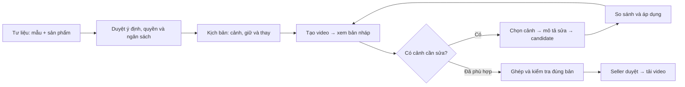

# Nghiên cứu UX remake của Higgsfield cho Viraldy

Ngày đối chiếu: **25/11/2026**, giờ Việt Nam.

**Quyết định đề xuất:** giữ luồng ba bước của Viraldy, rút gọn các quyết định ở đầu vào và tập trung màn kết quả vào video, cảnh cần sửa và hành động tiếp theo. Học cách Higgsfield cho người dùng bắt đầu từ một ví dụ cụ thể, mô tả thay đổi bằng ngôn ngữ thường và tiếp tục sửa từ kết quả đã có.

Đây là nghiên cứu cạnh tranh và chẩn đoán sản phẩm. Các tác động tới chuyển đổi, chi phí và thời gian hoàn thành dưới đây là giả thuyết cần đo.

**Phạm vi và độ tin cậy**

- Quan sát trực tiếp giao diện công khai Ad Multiplier và demo Editing Room trên desktop. Đã mở hai bước Reference/Changes và chọn một edit trong timeline demo; chưa upload tư liệu hay chạy generation.
- Đối chiếu Help Center, blog và changelog chính thức. Phân biệt các mô tả của nhà cung cấp với hành vi đã quan sát.
- Đọc working tree Viraldy qua GitNexus và file thực. Repo `viraldy` được index ngày 25/11/2026 lúc 20:15 giờ Việt Nam, không báo chậm commit; working tree đang được cập nhật song song nên mã thực được ưu tiên khi khác index hoặc tài liệu lịch sử. Nhận định hiện trạng là snapshot của lượt nghiên cứu này; liên kết dùng tên file để tránh mốc dòng dịch chuyển.
- Chưa kiểm thử toàn bộ giao diện Viraldy đang chạy, chưa phỏng vấn seller, chưa đo chất lượng video hay phát sinh chi phí AI. Chỉ thêm tài liệu nghiên cứu này.

**1. Chọn đúng sản phẩm để tham chiếu**

Trong các nguồn đã xem, Higgsfield phân phối nhu cầu tương đương Smart Remake qua nhiều công cụ:

| Công cụ | Công việc người dùng muốn hoàn thành | Điều cần học cho Viraldy |
| --- | --- | --- |
| Ad Multiplier | Từ một quảng cáo mẫu, đổi sản phẩm, nhân vật, bối cảnh hoặc thông điệp; tạo thêm biến thể. | Đường vào theo video mẫu và thay đổi mong muốn. [Giới thiệu chính thức, 06/10/2026](https://higgsfield.ai/blog/ad-multiplier-ads-studio). |
| Genjutsu | Chuyển chuyển động sang cảnh mới hoặc thay một thành phần trong video. | Phân biệt rõ tái dựng cảnh và thay chi tiết. [Help Center, 26/10/2026](https://higgsfield.ai/creator-hub/help-center/tools/how-do-i-use-genjutsu). |
| Marketing Studio / Ad Reference | Dùng cấu trúc và format của quảng cáo mẫu cho sản phẩm của mình. | Chọn mẫu, gắn sản phẩm, xem kết quả; template không bắt viết prompt. [Help Center, 01/08/2026](https://higgsfield.ai/creator-hub/help-center/tools/how-do-i-use-marketing-studio-to-create-video-ads). |
| Katana | Làm lại một edit theo reference và tiếp tục sửa trong cùng cuộc trò chuyện. | Kết quả trở thành điểm bắt đầu của lần chỉnh tiếp theo. [Help Center, 29/10/2026](https://higgsfield.ai/creator-hub/help-center/integrations/how-do-i-use-katana). |
| Editing Room | Chọn một đoạn trong footage và sửa người, góc quay, bối cảnh, camera, ánh sáng hoặc vùng ảnh. | Đặt cảnh, phạm vi sửa, phiên bản và preview trong cùng workspace. [Giới thiệu chính thức, 21/11/2026](https://higgsfield.ai/blog/higgsfield-editing-room). |

Không nên dùng từ “remake” để ngầm hứa cùng một mức bảo toàn hình ảnh cho mọi luồng. Với Viraldy hiện tại, tái tạo theo cấu trúc và nhịp mẫu là mô tả phù hợp hơn cho kết quả generation; giữ asset của cảnh không sửa là cam kết hệ thống có thể kiểm chứng riêng.

**2. Những gì quan sát trực tiếp được ở Higgsfield**

**Ad Multiplier — hai bước, một ý định rõ.** Cửa sổ có Reference và Changes. Reference đặt vùng upload lớn cùng ba tab Uploads, Generations, Liked. Changes có vùng thêm ảnh nhân vật/sản phẩm/quần áo, một ô mô tả thay đổi với gợi ý dùng `@`, chọn độ phân giải và CTA Generate. Có thể mở xem bước Changes khi chưa thêm reference; CTA tạo vẫn bị khóa. Phần hướng dẫn gồm bốn ví dụ: một quảng cáo nhiều phiên bản, đổi hook/CTA, thay thông điệp và tạo theo nhóm. [Giao diện đã quan sát](https://higgsfield.ai/ads-studio?tool=ad-multiplier).

**Suy luận UX:** người mới chỉ phải hiểu “lấy mẫu nào” và “muốn thay gì”. Ví dụ cụ thể giúp hình dung kết quả trước khi học cách cấu hình. Tuy vậy, ô mô tả tự do và ký hiệu `@` vẫn đòi hỏi người dùng diễn đạt đúng; chưa có bằng chứng giao diện này tự giải quyết mọi yêu cầu mâu thuẫn.

**Editing Room — học bằng thao tác trên demo.** Màn đầu có video demo được gắn nhãn, timeline nhiều edit, danh sách công cụ diễn đạt theo hành động và nút upload video riêng. Khi chọn edit Swap person trong demo, panel hiện thời lượng đoạn, History, ảnh tham chiếu, Prompt tùy chọn, Quality, Batch size và giá ngay nút Generate new. Có My videos và Export trong workspace. Đây là quan sát giao diện, chưa phải thử khả năng xử lý video thật. [Giao diện đã quan sát](https://higgsfield.ai/editing-room).

**Suy luận UX:** demo có thể thao tác giúp người dùng hiểu phạm vi sửa và lịch sử trước khi đưa tài sản của mình vào. Panel thay theo đoạn đang chọn giữ ngữ cảnh tốt. Timeline nhiều lớp phù hợp chỉnh sâu, nhưng có thể quá nặng với seller chỉ cần đổi sản phẩm.

**3. Các mẫu trải nghiệm đáng học từ tài liệu**

| Mẫu trải nghiệm | Bằng chứng từ Higgsfield | Áp dụng cho Viraldy |
| --- | --- | --- |
| Chọn kết quả muốn có trước | Marketing Studio tổ chức template theo nhiệm vụ; người dùng thêm sản phẩm rồi Recreate. | Cho xem mẫu và mô tả “sản phẩm của bạn sẽ xuất hiện thế nào”; giữ đường vào từ Creative Library. [Marketing Studio](https://higgsfield.ai/creator-hub/help-center/tools/how-do-i-use-marketing-studio-to-create-video-ads). |
| Giữ/thay có nghĩa khác nhau | Genjutsu phân biệt Motion transfer tái dựng cảnh và Objects swap thay thành phần. | Hiện tóm tắt “Học từ mẫu / Dùng của bạn / Cần kiểm tra lại”, tránh hứa giữ mọi chi tiết trong cảnh được tạo lại. [Genjutsu](https://higgsfield.ai/creator-hub/help-center/tools/how-do-i-use-genjutsu). |
| Giá gắn với hành động | Ad Multiplier hiện giá trên Generate; giá phụ thuộc đầu vào và thay đổi. | Hiện dự toán hoặc khoảng có căn cứ cạnh CTA; kiểm soát trần ở server. [Ad Multiplier](https://higgsfield.ai/blog/ad-multiplier-ads-studio). |
| Sửa tiếp từ bản đã có | Katana mô tả follow-up chỉ tạo lại shot bị ảnh hưởng; chỉnh timing/cut không phát sinh generation credits. | Phân biệt “Chỉnh đoạn cắt” và “Tạo cảnh mới”; giữ candidate và bản đang dùng. Đây là mô tả chính thức của Higgsfield, chưa được nghiên cứu này đo độc lập. [Katana](https://higgsfield.ai/creator-hub/help-center/integrations/how-do-i-use-katana). |
| So sánh và lịch sử ngay tại edit | Editing Room có History, Split, Compare và Final; project tự lưu. | Cho xem reference, bản đang dùng và candidate trong ngữ cảnh cảnh đang chọn; hiển thị trạng thái lưu. [Editing Room](https://higgsfield.ai/blog/higgsfield-editing-room). |
| Tư liệu dùng lại được | Assets tự lưu media, có folder, tìm kiếm, Favorites; asset có Recreate và Reference. | Ưu tiên tiếp tục dự án và dùng lại sản phẩm trước khi làm batch lớn. [Tài khoản và Assets](https://higgsfield.ai/creator-hub/help-center/getting-started/whats-in-my-higgsfield-account). |

**4. Viraldy hiện có gì và ma sát nằm ở đâu**

Luồng đang có trong mã là **Tư liệu → Kịch bản → Xem & ghép**. Nền tảng đáng giữ gồm preview mẫu, prompt tự động thu gọn, sửa từng cảnh, candidate không tự thay bản cũ, lịch sử và kiểm tra trước xuất. Storyboard đã có tóm tắt giữ/thay và thu gọn cấu hình kỹ thuật; phần quyền/ngân sách ở kết quả và chi tiết rubric cũng đã được thu gọn. Đây là bằng chứng triển khai, chưa phải kết quả usability. [Luồng ba bước](/Users/mac/Desktop/Viraldy/apps/web/src/features/smart-remake/components/remake-journey.tsx), [điều kiện duyệt/xuất](/Users/mac/Desktop/Viraldy/apps/web/src/features/smart-remake/components/remake-project-controls.tsx).

| Điểm đối chiếu | Hiện trạng đã đọc | Khoảng trống cần xử lý |
| --- | --- | --- |
| Đường vào từ mẫu | Creative Library preview rồi chuyển file bằng “Dùng video này”. | Giữ context mẫu/sản phẩm khi chuyển và khi mở lại; handoff hiện dùng bộ nhớ module. [Preview](/Users/mac/Desktop/Viraldy/apps/web/src/features/creative-library/components/creative-preview-dialog.tsx), [handoff](/Users/mac/Desktop/Viraldy/apps/web/src/features/smart-remake/lib/smart-remake-handoff.ts). |
| Intake | Có video, ảnh sản phẩm, brief; thêm mục tiêu và bốn vùng giữ/thay/cấm/claims. | Thu gọn yêu cầu bổ sung, giải thích mặc định trước; các ô tùy chọn vẫn tạo tải nhận thức khi hiện đồng thời. [Input](/Users/mac/Desktop/Viraldy/apps/web/src/features/smart-remake/components/remake-inputs.tsx), [requirements](/Users/mac/Desktop/Viraldy/apps/web/src/features/smart-remake/components/remake-project-inputs.tsx). |
| Ngân sách | Trần USD bắt đầu trống; có paid attempts và timeout giây. | Seller phải chọn giới hạn khi chưa rõ giá trị hoặc chi phí dự kiến. [Form](/Users/mac/Desktop/Viraldy/apps/web/src/features/smart-remake/components/remake-project-inputs.tsx), [defaults](/Users/mac/Desktop/Viraldy/apps/web/src/features/smart-remake/lib/use-remake-policy.ts). |
| Kịch bản | Nội dung cảnh dễ đọc, có tóm tắt giữ/thay và cấu hình kỹ thuật thu gọn; chỉnh chi tiết đi qua prompt nâng cao. | Giữ các cải tiến đã có, bổ sung chỉnh ý định cảnh bằng ngôn ngữ thường. [Scene và cấu hình](/Users/mac/Desktop/Viraldy/apps/web/src/features/smart-remake/components/remake-storyboard.tsx). |
| Sửa cảnh | Đã có chip vấn đề, yêu cầu sửa ngắn, prompt thu gọn; chip và yêu cầu được ghép vào video prompt. | Nâng lên yêu cầu có cấu trúc và ảnh tham chiếu theo cảnh; không cần làm lại chức năng nhập câu ngắn đã có. [Repair form](/Users/mac/Desktop/Viraldy/apps/web/src/features/smart-remake/components/remake-repair-form.tsx). |
| Xem và ghép | Từng cảnh cần chọn đoạn và “Dùng đoạn này”; sau đó ghép, inspection, duyệt nội dung và xuất. | Nhiều thao tác điều phối; nên tập trung next step và trạng thái sẵn sàng trong một vùng. [Trim](/Users/mac/Desktop/Viraldy/apps/web/src/features/smart-remake/components/remake-trim-tools.tsx), [release](/Users/mac/Desktop/Viraldy/apps/web/src/features/smart-remake/components/remake-project-controls.tsx). |
| Tiếp tục làm việc | Có project bền vững và restore theo project ID nhớ trong trình duyệt; repair draft lưu local. | Cần mục dự án gần đây, tên theo sản phẩm và trạng thái lưu chính xác. Chưa thấy danh sách nhiều project trong feature. [Resume](/Users/mac/Desktop/Viraldy/apps/web/src/features/smart-remake/lib/use-remake-studio.ts), [tên dự án](/Users/mac/Desktop/Viraldy/apps/web/src/features/smart-remake/lib/use-remake-policy.ts). |

Các giới hạn hiện tại cần thể hiện đúng: đoạn mẫu 8/16 giây, tối đa bốn cảnh và mỗi cảnh không quá tám giây; nhiều ảnh có trong UI nhưng owned-project intake gửi ảnh sản phẩm chính. Kho mẫu phía frontend có ranh giới lưu trên trình duyệt, khác với tư liệu project đã lưu backend. [Timeline](/Users/mac/Desktop/Viraldy/apps/web/src/features/smart-remake/lib/remake-timeline.ts), [project intake](/Users/mac/Desktop/Viraldy/apps/web/src/features/smart-remake/lib/use-remake-policy.ts), [kho video](/Users/mac/Desktop/Viraldy/apps/web/src/features/smart-remake/components/remake-video-library.tsx).

**5. Thứ tự tối ưu đề xuất**

Đây là đánh giá ưu tiên định tính từ độ trực tiếp của bằng chứng và phạm vi phụ thuộc, chưa phải estimate engineering hoặc kết quả A/B.

| Thứ tự | Thay đổi cụ thể | Độ tin cậy về vấn đề / phụ thuộc | Tiêu chí kiểm chứng |
| --- | --- | --- | --- |
| 1 | Gọn bước Tư liệu: video mẫu, sản phẩm, một ý định tùy chọn. Hiện mục tiêu mặc định: học cách quay/nhịp/thứ tự cảnh của mẫu và dùng sản phẩm người dùng. Yêu cầu chuyên sâu thu gọn; quyền hỏi theo tư liệu thực tế. | Cao về số trường đang có; cần usability để biết mức ảnh hưởng. Chủ yếu tổ chức UI và copy. | Seller bắt đầu được mà không cần giải thích keep/replace hay model; vẫn hiểu điều sẽ được tạo. |
| 2 | Ngân sách dễ hiểu: dự toán/khoảng theo server cạnh CTA, một trần người dùng chọn cho phiên. Attempts/timeout ở nâng cao. Giá phân tích có phí phải rõ trước phân tích. | Cao về form; phụ thuộc dữ liệu giá, reservation và ledger. Không tự sinh số dự toán. | Người dùng nói được lần bấm sắp tới tốn gì; server thực thi đúng trần. |
| 3 | Màn Xem & ghép ưu tiên preview, cảnh cần xem và một next step. Gom ghép/kiểm tra/duyệt/tải thành tiến trình dễ theo dõi. Giữ cách thu gọn cấu hình, rubric và quyền/ngân sách đã có. | Cao về số vùng điều phối; cần giữ các gate server hiện có. Đây là hoàn thiện điều phối, không phải xây lại phần advanced. | Seller tìm được hành động tiếp theo và hiểu vì sao chưa tải được. |
| 4 | Cải thiện repair sẵn có: loại vấn đề + mong muốn + reference đúng cảnh + tóm tắt giữ/thay/phạm vi/chi phí. Candidate, so sánh, áp dụng và khôi phục dùng năng lực hiện có. | Cao về năng lực hiện hữu; reference theo cảnh và sửa intent có cấu trúc cần backend/contract. | Sửa được chi tiết sai sản phẩm mà không mở prompt; cảnh khác giữ đúng asset. |
| 5 | Dự án gần đây và tái dùng tư liệu theo sản phẩm; lưu draft server và báo rõ phạm vi lưu. | Cao về hạn chế entry hiện tại; cần persistence và asset identity/version. | Mở lại đúng project sau reload; làm video thứ hai không phải tải lại tư liệu đã lưu. |
| 6 | Thử preview ghép tự chuẩn bị từ gợi ý cắt, gắn nhãn chưa duyệt; seller xem và chỉnh đoạn chưa đạt. | Trung bình; thay đổi contract preview/approval, cần kiểm tra timing, continuity và lời thoại thực tế. | Giảm thao tác chọn cắt lặp lại mà không tăng lỗi lọt qua hoặc tự duyệt nội dung. |
| 7 | Sau khi vòng đơn hoàn thành tốt: biến thể có mục tiêu như đổi hook, CTA hoặc sản phẩm, rồi mới batch. | Cần dữ liệu acceptance và chi phí; xác minh hỗ trợ nội dung tương ứng trước khi expose. | Biến thể giải quyết một mục tiêu rõ; không làm mất bản đã đạt hoặc vượt ngân sách. |

Giá và thời gian dự kiến là thông tin giúp ra quyết định nên vẫn xuất hiện ở luồng chính khi có dữ liệu đáng tin. Đưa diagnostics xuống nâng cao không có nghĩa giấu chi phí, lỗi hoặc chất lượng người dùng đang chọn. Ngân sách đã chọn được tái sử dụng trong phạm vi đã đồng ý; cập nhật chi phí trên CTA giúp tránh popup xác nhận từng job con.

**6. Luồng đích đề xuất trên desktop**

Giữ ba bước hiện có để giảm phạm vi thay đổi:

Ở bước Tư liệu, đặt video mẫu và sản phẩm cạnh nhau, cho xem ví dụ có gắn nhãn. CTA chính: **Xem kịch bản cho sản phẩm này**. Bước Kịch bản giữ nội dung cảnh, ảnh sản phẩm và tóm tắt giữ/thay đã có; bổ sung sửa yêu cầu ngắn tại từng cảnh. Bước Xem & ghép đặt preview lớn, danh sách cảnh bên cạnh và panel theo cảnh đang chọn; timeline chi tiết mở khi cần.

Ví dụ copy đề xuất cho repair: “Tạo phương án mới cho cảnh 2. Clip các cảnh khác được giữ. Chi tiết trong cảnh mới cần kiểm tra lại.” Nếu cảnh sửa cần tạo clip thô tám giây, UI phải nói rõ điều đó dù đoạn xuất chỉ dùng ba giây. Mốc nguồn, đoạn clip AI và phạm vi generation là ba khái niệm cần diễn đạt bằng video/filmstrip và nhãn gần thao tác.

Preview tự ghép là hướng thử nghiệm riêng: chỉ dùng lựa chọn gợi ý hợp lệ, luôn có trạng thái chưa duyệt; không tự đánh dấu approved hay xuất bản. Việc này cần thiết kế contract mới vì gate hiện tại yêu cầu duyệt từng đoạn trước compose. Chi phí AI mới ngoài phạm vi đã chọn phải được người dùng chấp thuận; compose/QA vẫn cần được tính vào ngân sách thực tế.

**7. Những điểm nên chọn lọc khi học Higgsfield**

- Nhiều công cụ với nhiệm vụ chồng lấn làm discovery phức tạp. Viraldy có thể giữ một workspace theo công việc seller, dùng tùy chọn theo ngữ cảnh.
- Không bắt seller dùng `@image` để chỉ định ảnh; thumbnail có vai trò “Sản phẩm”, “Nhân vật”, “Bối cảnh” dễ hiểu hơn. Tham chiếu bằng `@` có thể dành cho người dùng nâng cao.
- Các control chỉ nên xuất hiện khi backend thực sự hỗ trợ. Đổi audio, avatar, hook hoặc CTA không thể suy ra chỉ từ việc có một ô prompt.
- Preset giảm quyết định nhưng có thể khóa format. Guide của Higgsfield nói cửa sổ Recreate Template không có ratio/duration/resolution, muốn tự chọn cần chuyển sang prompt bar. Viraldy nên hiển thị giới hạn ngay tại mẫu và giữ chỉnh có ý nghĩa trong cùng luồng. [Guide, 30/10/2026](https://higgsfield.ai/blog/ai-product-videos-no-studio).
- Claim bảo toàn chuyển động, nhân vật hoặc cảnh của nhà cung cấp chưa xác lập chất lượng thực tế trên dữ liệu seller. Tương tự, độ phổ biến template không chứng minh hiệu quả quảng cáo.

**8. Cách xác thực trước khi mở rộng**

Thử định tính với **5–8 seller** có sản phẩm và video mẫu thật, dùng quyền và ngân sách đã chọn trước. Đây là cỡ mẫu discovery đề xuất, không đủ để khẳng định uplift thống kê.

Ba task: tạo kịch bản từ mẫu; sửa một cảnh sai chi tiết sản phẩm; mở lại đúng dự án và hoàn tất tải bản đã duyệt. Dùng cùng nhiệm vụ để so luồng hiện tại với prototype đã rút gọn. Ghi thời gian thao tác chủ động riêng với thời gian chờ AI, số lần cần hướng dẫn, số trường người dùng không hiểu và lý do bỏ cuộc.

Chỉ số quyết định: tỷ lệ hoàn thành một video seller chấp nhận trong trần ngân sách/thời gian; tổng chi phí tới kết quả được chấp nhận, kể cả phiên thất bại; acceptance của candidate và rollback; mức hiểu đúng phạm vi sửa; lỗi sản phẩm/timing còn sót; khả năng tiếp tục sau reload. Kiểm tra riêng asset của cảnh không sửa và generation trùng.

Khởi đầu bằng thay đổi 1–3. Nếu seller vẫn khó hoàn thành vì chất lượng cảnh, ưu tiên vòng intent/reference/repair trước khi tăng template, thời lượng hoặc batch. Chưa có dữ liệu để hứa giảm bao nhiêu phần trăm chi phí hoặc tăng doanh số.

**Ghi chú nguồn và giới hạn**

Higgsfield cập nhật nhanh. Help Center Katana mô tả đường vào Claude, trong khi trang MCP có nội dung theo assistant; nghiên cứu này chỉ dùng bài học về workflow, không kết luận mọi kênh có cùng capability. Một số tài liệu Genjutsu khác nhau về độ phân giải và pricing; không dùng số giá tĩnh làm chuẩn cho Viraldy. Nguồn tháng 7–8 hỗ trợ hiểu mô hình Assets/template nhưng giao diện hiện tại có thể đã đổi; quan sát ngày 25/11 được ghi riêng ở phần 2. Bản thân tài liệu sản phẩm Viraldy có nhiều lớp bàn giao lịch sử nên các nhận định hiện trạng phía trên được đối chiếu với mã.
